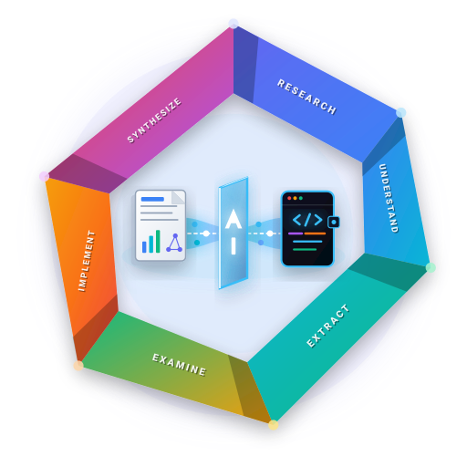
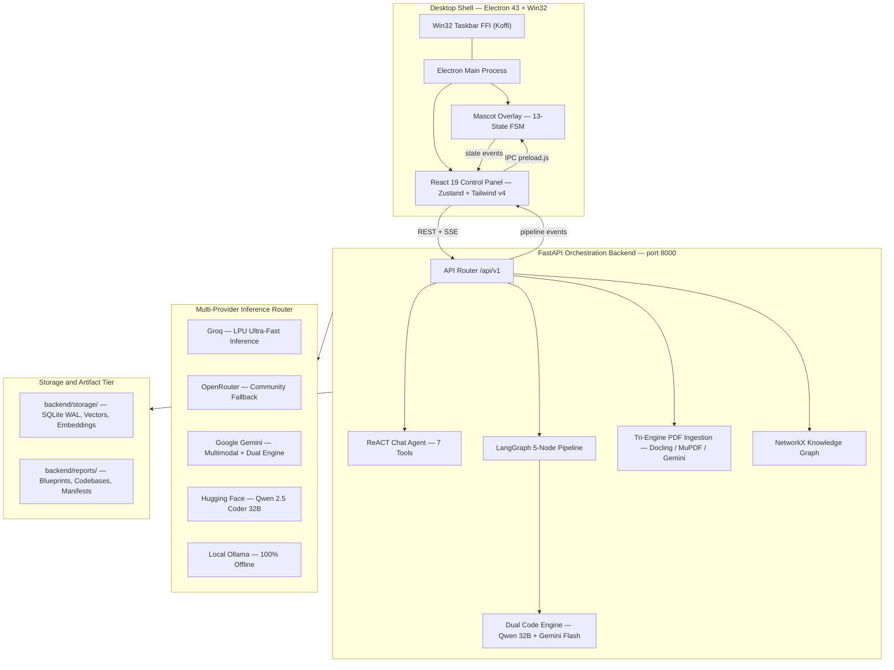

<p align="center">
  
</p>

# 🌌 RUEXIS AI (v2.0) — Autonomous Paper-to-Code Desktop Companion

<p align="center">
  <strong>R</strong>esearch · <strong>U</strong>nderstand · <strong>E</strong>xtract · e<strong>X</strong>amine · <strong>I</strong>mplement · <strong>S</strong>ynthesize
</p>

<p align="center">
  <em>An autonomous, local-first agentic desktop platform that transforms complex scientific literature into verified, runnable PyTorch implementations, accompanied by an animated Win32 desktop companion.</em>
</p>

<p align="center">
  
  
  
  
  
</p>
<p align="center">
  
  
  
  
</p>

---

<!-- ================================================================= -->
<!-- HERO SHOWCASE / SCREENSHOT PLACEHOLDER                             -->
<!-- ================================================================= -->
<p align="center">
  
</p>
<p align="center">
  <em><!-- [PLACEHOLDER: Hero Screenshot / Demo GIF: Floating Desktop Mascot & Open React Control Panel] --></em>
</p>

---

## 🌟 What is RUEXIS AI?

Scholarly machine learning research moves faster than reproducibility. **RUEXIS AI** bridges the gap between academic theory and running software. Given an academic PDF, RUEXIS analyzes mathematics, architecture diagrams, and algorithmic pseudocode through a **6-stage autonomous lifecycle**:

| Stage | Name | Core Technology | Primary Operation |
|:---:|:---|:---|:---|
| **R** | **Research** | Docling + PyMuPDF + Gemini OCR | Tri-engine multimodal document parsing, layout extraction & equation segmentation |
| **U** | **Understand** | ReACT Agent + FAISS + NetworkX KG | Interactive conversational agent equipped with 7 academic tools & citation grounding |
| **E** | **Extract** | Structured JSON Pydantic Schemas | Deterministic extraction of hyperparameters, tensor shapes, loss equations & benchmarks |
| **X** | **eXamine** | Hardware Profiler + VRAM Heuristics | Feasibility analysis scoring models against host CPU, GPU VRAM, and memory limits |
| **I** | **Implement** | Dual Code Synthesis Engine | Parallel synthesis via `Qwen 2.5 Coder 32B` (syntax) and `Gemini 2.5 Flash` (reasoning) |
| **S** | **Synthesize** | 12-Rung AST Verification Ladder | Abstract Syntax Tree validation, packaging, project templating & mascot status sync |

---

## 🏛️ System Architecture

RUEXIS AI links an unconstrained Win32 desktop overlay with an asynchronous local agentic backend and a multi-provider LLM pool:




---

## 🎯 Key Capabilities & Active Engineering Focus

I am prioritizing three engineering pillars to deliver a production-grade experience:

```
┌─────────────────────────────────────────────────────────────────────────────────────────┐
│                               3 PILLARS OF EXCELLENCE                                   │
│  1. Proper Mascot Transitions   2. Proper Model Outputting   3. Packaging & Deployment  │
└─────────────────────────────────────────────────────────────────────────────────────────┘
```

### 1. 🎭 Proper Mascot Transitions & Desktop Presence

The desktop companion is not a static widget; it is a live reflection of what the autonomous agents are doing in real time.

```
                  ┌──────────────┐
                  │   SLEEPING   │
                  └──────┬───────┘
                         │ (User Interaction / Panel Open)
                         ▼
                  ┌──────────────┐
   ┌─────────────►│ STANDING/IDLE│◄─────────────┐
   │              └──────┬───────┘              │
   │ (Job Done)          │ (Analysis / Chat)    │ (Error / Recover)
┌──┴───────────┐         ▼        ┌─────────────┴┐
│   EXCITED    │  ┌──────────────┐│ ANGRY / WARN │
└──────────────┘  │ HUNCH/WORKING│└──────────────┘
                  └──────────────┘
```

- **Hub-and-Spoke Pose Router:** All 13 animation states route deterministically through Frame 0 of the standing pose (`idle`). When switching from `sleep` to `hunch`, the engine smoothly reverses `sleep` (Frame 2 ➔ 1 ➔ 0) before playing `hunch` (Frame 0 ➔ 1 ➔ 2), preventing abrupt visual snapping.
- **130ms Alpha Cross-Fading:** Eliminates sprite popping between states with a 6-step `globalAlpha` cross-blend.
- **4 Distinct Character Personalities:** `mr_nerdy`, `ms_nerdy`, `mr_nerd`, and `ms_nerd`.
- **Win32 Taskbar Avoidance:** Uses Koffi C FFI (`shell32.dll`) to detect taskbar edges (bottom, top, left, right) and reposition smoothly.
- **Lockstep Dragging & DPI Scaling:** Dragging the mascot moves the docked 340×480 React panel in synchronous real-time lockstep with zero cursor drift.

> 🛠️ **Ongoing Mascot Engineering:** Expanding context-aware micro-behaviors (e.g., sipping coffee during long VRAM sweeps, peeking when papers are opened in Chrome/Edge, and dynamic mood shifts tied to pipeline health).

<!-- PLACEHOLDER: Mascot Animation & Character Gallery -->
<p align="center">
  <em><!-- [PLACEHOLDER: Animated GIF showing smooth Mascot state transition from Idle -> Working -> Excited] --></em>
</p>

---

### 2. 🧠 Proper Model Outputting & Code Generation Integrity

Scientific code synthesis cannot tolerate syntax errors, missing imports, or phantom hyperparameters. RUEXIS AI enforces strict generation integrity:

```
Paper Specs ──► [Engine A: Qwen 2.5 Coder] ──┐
             ──► [Engine B: Gemini 2.5 Flash] ──┴─► [12-Rung AST Verification] ──► Verified PyTorch Repo
```

- **Dual Code Synthesis Engine:**
  - **Engine A (`Qwen/Qwen2.5-Coder-32B-Instruct`):** Specializes in idiomatic PyTorch tensor operations, clean module decomposition, and type-annotated forward passes.
  - **Engine B (`gemini-2.5-flash`):** Specializes in high-level architectural comprehension, loss function formulation, and parameter validation.
- **12-Rung AST Code Verification:** Every generated file is inspected for syntax validity, unreferenced variables, uninstantiated layers, and deprecated PyTorch APIs before being written to disk.
- **Real-Time ReACT Reasoning Streams:** Transparently streams intermediate model thoughts, tool invocations (arXiv, Google Scholar, FAISS), and observations using multi-line Server-Sent Events (SSE).
- **Auto-Failover Model Router:** If Groq or OpenRouter encounters rate limits (HTTP 429), the engine automatically reroutes to the next healthiest provider and updates the frontend model selector without interrupting user workflow.

> 🛠️ **Ongoing Model Outputting Engineering:** Expanding zero-shot executable repository generation, automated `pytest` test suites, and strict Pydantic hallucination guards for extracted hyperparameter configurations.

<!-- PLACEHOLDER: Model Output & Code Generation View -->
<p align="center">
  <em><!-- [PLACEHOLDER: Screenshot of Dual Engine Output / ReACT Reasoning Trace & PyTorch Blueprint] --></em>
</p>

---

### 3. 📦 Packaging, Standalone Distribution & Deployment

RUEXIS AI is designed to run locally on end-user machines with minimal friction. Packaging coordinates the native desktop shell with an embedded Python execution environment.

```
Development Mode                    Packaged Production Desktop (.exe)
─────────────────                   ───────────────────────────────────
Vite Dev Server (:5173)             Electron Container (AppShell)
       ▲                                   │ loads file://
Electron Container (main.js)        Embedded React SPA (renderer/dist/)
       │ REST / SSE                        │ localhost:8000
FastAPI Backend (:8000)             Embedded Python FastAPI Backend
                                    (Standalone PyInstaller / venv bundle)
```

- **Dual-Window Lifecycle:**
  - **Docked Mode (340×480 px):** Sits neatly docked above the desktop mascot.
  - **Maximized Mode (min 800×600 px):** Expands to a full-screen research workstation (`CommandOrControl+Shift+P`), automatically stashing the mascot overlay.
- **Native C++ Module Rules (`koffi`):** Native Win32 C bindings require `asarUnpack: ["**/*.node"]` in `electron-builder` configuration to prevent archive extraction failures at runtime.
- **Process Supervision:** The Electron main process acts as supervisor, auto-spawning the Python backend process on startup and reliably terminating child processes on application quit (`app.on('will-quit')`).

> 📖 **Full Deployment Guide:** Read the comprehensive operational manual at [`documents/packaging_and_deployment.md`](./documents/packaging_and_deployment.md) for Windows installer building, code signing, and embedded runtime distribution.

<!-- PLACEHOLDER: Packaging & Installer Screenshot -->
<p align="center">
  <em><!-- [PLACEHOLDER: Screenshot of Windows Desktop Installer & Packaged RUEXIS App Launch] --></em>
</p>

---

## ⚡ Quickstart Guide

### Prerequisites
- **Node.js**: `v20.x` or higher
- **Python**: `3.11` or `3.12`
- **Package Managers**: `npm` and `pip` (or `uv`)

### 1. Clone & Configure Environment
```bash
git clone https://github.com/varunchandra10/Paper-2-Project.git
cd Paper-2-Project

# Copy environment configuration
cp backend/.env.example backend/.env
```

Add your API keys inside `backend/.env`:
```env
SECRET_KEY=your_jwt_secret_key
GROQ_API_KEY=your_groq_api_key
OPENROUTER_API_KEY=your_openrouter_api_key
GEMINI_API_KEY=your_gemini_api_key
HUGGINGFACE_API_KEY=your_huggingface_api_key
TAVILY_API_KEY=your_tavily_search_api_key
```

### 2. Start the Backend Server
```bash
cd backend
python -m venv .venv
# Windows:
.venv\Scripts\activate
# Linux/macOS:
source .venv/bin/activate

pip install -r requirements.txt
uvicorn main:app --host 127.0.0.1 --port 8000 --reload
```

### 3. Launch Frontend (Renderer + Electron)
```bash
# Terminal A: Start React Renderer Dev Server
cd frontend/renderer
npm install
npm run dev

# Terminal B: Start Electron Desktop Shell
cd frontend/electron_app
npm install
npm start
```

---

## 📚 Master Documentation & Architecture Textbook

For deep technical insights, explore the **RUEXIS AI Documentation Suite**:

### 📘 Master Engineering Textbook
- [**Master Engineering Textbook Index**](./documents/README.md) — Unified textbook connecting all system layers.

### 🔬 Specialized System Guides
| Guide | Document Path | Focus Area |
|:---|:---|:---|
| **Packaging & Deployment** | [`documents/packaging_and_deployment.md`](./documents/packaging_and_deployment.md) | Windows installer generation, ASAR unpacking, embedded runtimes |
| **Testing & Benchmarks** | [`documents/testing_and_benchmarking.md`](./documents/testing_and_benchmarking.md) | Unit tests, pytest-asyncio suites, RAG evaluation metrics |
| **LangGraph Swarm** | [`documents/agents_langgraph.md`](./documents/agents_langgraph.md) | 5-node autonomous pipeline graph & state transitions |
| **PDF Extraction** | [`documents/extraction_pipeline.md`](./documents/extraction_pipeline.md) | Docling, PyMuPDF, and Gemini multimodal OCR fallback |
| **Core Infrastructure** | [`documents/core_infrastructure.md`](./documents/core_infrastructure.md) | ModelRouter, QuotaTracker, SQLite WAL JobStore, CodeVerifier |
| **Backend Reference** | [`documents/backend_explanation.md`](./documents/backend_explanation.md) | Comprehensive backend architecture and endpoint breakdown |
| **Backend Commands** | [`documents/backend_commands.md`](./documents/backend_commands.md) | Cheatsheet of backend commands, migrations, and test scripts |
| **Frontend Architecture** | [`documents/frontend_explanation.md`](./documents/frontend_explanation.md) | Dual-window model, React 19 layout, and Zustand store slices |
| **Frontend Commands** | [`documents/frontend_commands.md`](./documents/frontend_commands.md) | Build commands, typechecking, and multi-terminal orchestration |
| **Developer Contributing** | [`documents/developer_contributing.md`](./documents/developer_contributing.md) | Code style, pull request lifecycle, and testing requirements |

### 📂 Component READMEs
- [**Backend README**](./backend/README.md) — FastAPI endpoints, agent workflows, storage partitioning.
- [**Frontend Overview README**](./frontend/README.md) — Dual-window architecture, 4-mode theme engine.
- [**Electron App README**](./frontend/electron_app/README.md) — Win32 Koffi FFI, window manager, mascot engine.
- [**React Renderer README**](./frontend/renderer/README.md) — React 19 UI views, 8 Zustand slices, Vite setup.

---

## 📜 License

This project is licensed under the **MIT License** — see the [LICENSE](./LICENSE) file for details.

---

## 👤 Author & Maintainer

**Kola Varun Chandra**

[](https://github.com/varunchandra10)
[](https://www.linkedin.com/in/kola-varun-chandra-702137391)

---

<p align="center">
  <sub>Built with passion for autonomous scientific discovery and open-source reproducibility.</sub>
</p>
