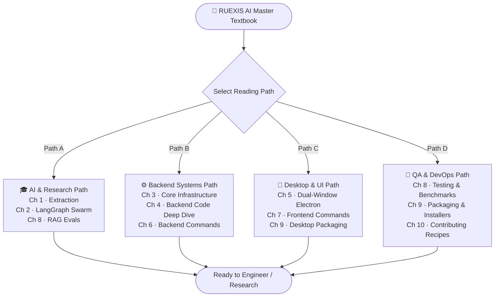
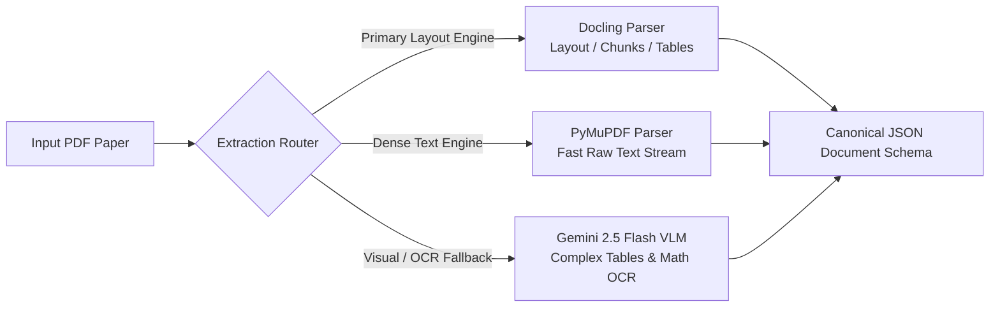
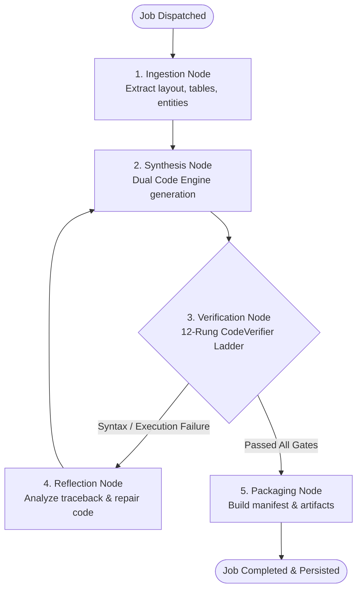
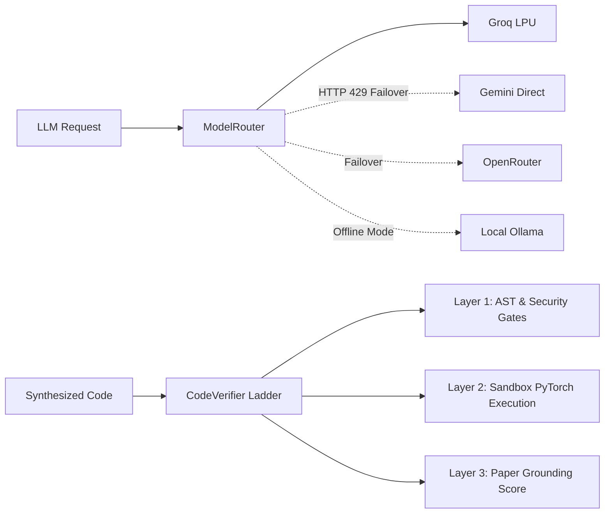
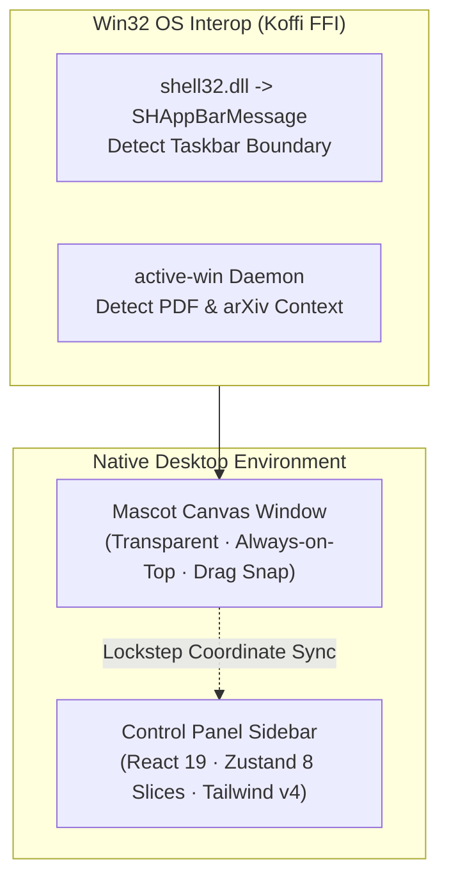

# 📘 RUEXIS AI — Master Engineering Textbook & Documentation Index

> **The Comprehensive Reference Manual for the RUEXIS AI Multimodal Scholarly Paper-to-Code Autonomous Platform (v2.0)**  
> *A unified, textbook-style index connecting system architecture, agent orchestration, native desktop integration, backend subsystems, testing strategies, and deployment.*

---

## 📖 Book Preface: The RUEXIS AI Paradigm

Modern scholarly research moves faster than human reproducibility. **RUEXIS AI** (formerly *Marginalia*) transforms academic papers from static PDF documents into fully verified, runnable codebases, interactive knowledge graphs, and real-time desktop companion intelligence.

Unlike naive RAG systems that merely summarize text, RUEXIS AI employs an **autonomous 5-node LangGraph agent swarm**, a **Dual Code Synthesis Engine** combining distinct reasoning models, an **isolated 12-rung code verification ladder**, and an **unconstrained native Win32 desktop mascot container** floating above the user's workspace.

```
                                  RUEXIS AI PLATFORM
                                 ═══════════════════
   ┌─────────────────────────────────────────────────────────────────────────────┐
   │                               Desktop Layer                                 │
   │   [Mr. Nerdy Canvas Mascot] ──Lockstep Drag── [React 19 Sidebar Panel]      │
   │        (Win32 Koffi FFI)                         (Tailwind v4 / Zustand)    │
   └──────────────────────────────────────┬──────────────────────────────────────┘
                                          │ IPC / Local REST (:8000) / SSE Streams
   ┌──────────────────────────────────────▼──────────────────────────────────────┐
   │                            FastAPI Backend Server                           │
   │  ┌───────────────────────┐ ┌──────────────────────┐ ┌────────────────────┐  │
   │  │   Multi-Engine PDF    │ │ LangGraph Autonomous │ │  Dual Code Engine  │  │
   │  │  Extraction Pipeline  │ │      Agent Swarm     │ │  (Qwen 32B +       │  │
   │  │ (Docling/MuPDF/Gemini)│ │   (5-Node Pipeline)  │ │   Gemini Flash)    │  │
   │  └───────────────────────┘ └──────────────────────┘ └────────────────────┘  │
   │  ┌───────────────────────────────────────────────────────────────────────┐  │
   │  │ Core Infrastructure: ModelRouter · QuotaTracker · SQLite JobStore WAL │  │
   │  │ 12-Rung CodeVerifier · 7-Tier NetworkX Knowledge Graph · Hybrid Search │  │
   │  └───────────────────────────────────────────────────────────────────────┘  │
   └──────────────────────────────────────┬──────────────────────────────────────┘
                                          │ Deterministic File Partitioning
   ┌──────────────────────────────────────▼──────────────────────────────────────┐
   │                               Storage Tier                                  │
   │   storage/ (Runtime DBs, Embeddings)  │  reports/ (Manifests, Codebases)   │
   └─────────────────────────────────────────────────────────────────────────────┘
```

---

## 🗺️ Curriculum Map & Reading Pathways

Choose a reading pathway tailored to your engineering focus:



---

## 📚 Table of Contents

### [Part I: Multimodal Document Ingestion & Vision Intelligence](#part-i-multimodal-document-ingestion--vision-intelligence)
* **Chapter 1:** Multi-Engine PDF Layout & VLM Extraction Pipeline
  * Document: [extraction_pipeline.md](./extraction_pipeline.md)

### [Part II: Autonomous Agentic Orchestration](#part-ii-autonomous-agentic-orchestration)
* **Chapter 2:** The 5-Node LangGraph Agent Swarm & Reflection Topology
  * Document: [agents_langgraph.md](./agents_langgraph.md)

### [Part III: Core Infrastructure, State & Verification](#part-iii-core-infrastructure-state--verification)
* **Chapter 3:** Model Routing, Quota Systems, SQLite JobStore & 12-Rung Verification
  * Document: [core_infrastructure.md](./core_infrastructure.md)
* **Chapter 4:** Exhaustive Backend Implementation & Python Module Anatomy
  * Document: [backend_explanation.md](./backend_explanation.md)

### [Part IV: Desktop Container, Canvas Engine & Modern UI](#part-iv-desktop-container-canvas-engine--modern-ui)
* **Chapter 5:** Native Win32 Dual-Window Electron, HTML5 Canvas Mascot & React 19 UI
  * Document: [frontend_explanation.md](./frontend_explanation.md)

### [Part V: Operational Playbooks, Quality Assurance & Distribution](#part-v-operational-playbooks-quality-assurance--distribution)
* **Chapter 6:** Backend Operational Playbook, Environment & API Quick-Test Suite
  * Document: [backend_commands.md](./backend_commands.md)
* **Chapter 7:** Frontend & Electron Development Scripts, Hotkeys & Theme Controls
  * Document: [frontend_commands.md](./frontend_commands.md)
* **Chapter 8:** Testing Strategy, Deterministic Mocking & RAG Evaluation Harness
  * Document: [testing_and_benchmarking.md](./testing_and_benchmarking.md)
* **Chapter 9:** Production Packaging, NSIS Windows Installer & Air-Gapped Deployment
  * Document: [packaging_and_deployment.md](./packaging_and_deployment.md)
* **Chapter 10:** Contributor Extension Recipes (Adding Providers, Tools, Stores & IPC)
  * Document: [developer_contributing.md](./developer_contributing.md)

### [Part VI: Historical Architecture & Evolution](#part-vi-historical-architecture--evolution)
* **Release Baseline & Inventory:** [v2/baseline.md](./v2/baseline.md)
* **V2 Architecture Specs:** [v2/architecture-current.md](./v2/architecture-current.md)
* **Release Changelog:** [v2/changelog.md](./v2/changelog.md)
* **Known Issues Registry:** [v2/known-issues.md](./v2/known-issues.md)

---

## Part I: Multimodal Document Ingestion & Vision Intelligence

### 📄 Chapter 1: The Multi-Engine PDF & VLM Pipeline
*Primary Document:* **[extraction_pipeline.md](./extraction_pipeline.md)**



**Core Concepts Taught:**
1. **Three-Tier Extraction Fallback:** Why single-parser extraction fails on scientific literature, and how Docling handles two-column layouts while PyMuPDF provides raw fallback and Gemini 2.5 Flash VLM parses handwritten math and dense graphics.
2. **Quota-Gated Vision Requests:** How `DailyQuotaManager` gates VLM visual queries (200 requests/day ceiling) to prevent unexpected cloud API billing spikes.
3. **Canonical Representation:** Normalization of raw text, parsed formulas, table matrices, and figure references into a uniform structured JSON schema ready for vector embeddings.

---

## Part II: Autonomous Agentic Orchestration

### 🤖 Chapter 2: The 5-Node LangGraph Agent Swarm
*Primary Document:* **[agents_langgraph.md](./agents_langgraph.md)**



**Core Concepts Taught:**
1. **StateGraph Lifecycle:** How state flows through a typed `GraphState` dictionary carrying paper metadata, code ASTs, and verification logs.
2. **Reflection Loops:** When synthesized code fails syntax or tensor shape verification, the system does not fail; it routes to `ReflectionNode`, passing tracebacks back to the LLM for self-repair (capped at 3 iterations).
3. **Real-Time Telemetry Broadcasting:** How every node transition updates the SQLite `jobs.db` and pushes live status events across the Server-Sent Events (SSE) pipe.

---

## Part III: Core Infrastructure, State & Verification

### ⚙️ Chapter 3: High-Availability Infrastructure, Routing & Verification
*Primary Document:* **[core_infrastructure.md](./core_infrastructure.md)**



**Core Concepts Taught:**
1. **ModelRouter & 3-Step Failover Chain:** Seamless fallback mechanisms across Groq, Gemini, OpenRouter, and local Ollama when API quotas or rate limits hit.
2. **Dual-Layer Quota System:** Header-based rate limit extraction (`QuotaTracker`) combined with daily paper quotas (`DailyQuotaManager`).
3. **12-Rung Code Verification Ladder:** A rigorous validation pipeline checking AST grammar, banned security primitives (`eval`, `exec`), tensor shapes, backward pass gradient flow, and hyperparameter fidelity.
4. **Knowledge Graph Engine:** 7-tier NetworkX directed graph modeling concepts, components, datasets, and citation hierarchies.

---

### 🐍 Chapter 4: Exhaustive Backend Code Architecture
*Primary Document:* **[backend_explanation.md](./backend_explanation.md)**

**Core Concepts Taught:**
1. **Modular Router Surface:** Deep dive into all 7 FastAPI endpoint routers (`auth`, `papers`, `pipeline`, `chat`, `models`, `hardware`, `telemetry`).
2. **Atomic JSON Database (`ChatDatabase`):** Thread-safe atomic file transactions using Python re-entrant locks (`RLock`) for conversation histories, users, and episodic step memory.
3. **Hardware Telemetry Engine:** Dynamic VRAM, RAM, and CUDA probe integration via `psutil` and `torch.cuda`.

---

## Part IV: Desktop Container, Canvas Engine & Modern UI

### 🎨 Chapter 5: Dual-Window Desktop Architecture & Mascot Engine
*Primary Document:* **[frontend_explanation.md](./frontend_explanation.md)**



**Core Concepts Taught:**
1. **Dual-Window Lockstep System:** Running an unconstrained HTML5 transparent mascot window lockstep-coordinated with a floating sidebar panel.
2. **Win32 FFI via Koffi:** Interfacing with Windows `shell32.dll` to read taskbar positioning and clamp the mascot safely within the active monitor workspace.
3. **Canvas Sprite Engine:** 130ms alpha-blended sprite animation state machine with multi-skin support (`mr_nerdy`, `cyber_bot`, `pixel_owl`).
4. **Zustand Slice Architecture:** 8 segregated slices managing UI state, uploads, chat history, live SSE telemetry, and themes.

---

## Part V: Operational Playbooks, Quality Assurance & Distribution

### 🛠️ Chapters 6 & 7: Operational Command Handbooks
*Backend Reference:* **[backend_commands.md](./backend_commands.md)**  
*Frontend Reference:* **[frontend_commands.md](./frontend_commands.md)**

**Core Concepts Taught:**
* Setting up Python virtual environments and Node.js dependencies.
* Executing full V2 curl commands for auth onboarding, SSE streams, and dual code synthesis.
* Rebuilding native C++ modules (`koffi`, `active-win`) using `electron-rebuild`.
* Global hotkeys (`Ctrl+Shift+P`) and multi-terminal launch workflows.

---

### 🧪 Chapter 8: Testing Strategy, Mocking & RAG Evaluation
*Primary Document:* **[testing_and_benchmarking.md](./testing_and_benchmarking.md)**

**Core Concepts Taught:**
* **The 35-File Test Suite:** Structured breakdown of tests covering APIs, Extraction, LangGraph, Core Infrastructure, and Telemetry.
* **Deterministic Cloud Mocking:** Testing complex failover chains without spending API tokens.
* **RAG Benchmark Harness:** Using `POST /api/v1/evals/run-rag` to compute mathematical grounding scores (0–100) and citation precision.

---

### 📦 Chapter 9: Desktop Packaging & Production Deployment
*Primary Document:* **[packaging_and_deployment.md](./packaging_and_deployment.md)**

**Core Concepts Taught:**
* **Production Packaging with `electron-builder`:** Creating Windows NSIS standalone installers (`npm run dist`).
* **`.asar` Unpacking Rules:** Configuring unpack directives so the OS loader can execute native `.node` binary dynamic libraries.
* **100% Offline Air-Gapped Mode:** Pre-caching Ollama weights for zero-cloud environments.

---

### 🚀 Chapter 10: Contributor Extension Recipes
*Primary Document:* **[developer_contributing.md](./developer_contributing.md)**

**Core Concepts Taught:**
* Step-by-step code recipe for plugging in a **new LLM provider**.
* Step-by-step code recipe for writing and binding a **new LangGraph agent tool**.
* Step-by-step code recipe for creating a **new Zustand UI state slice**.
* Step-by-step code recipe for adding **native Electron IPC channels**.

---

## 🗂️ Complete File & Path Cross-Reference

| Document File | Core Subject | Primary Diagram Language |
|---|---|:---:|
| [README.md](./README.md) | **Master Textbook & Entrypoint** | Mermaid & ASCII |
| [extraction_pipeline.md](./extraction_pipeline.md) | PDF Extraction, Docling & Gemini VLM | Mermaid Flowchart |
| [agents_langgraph.md](./agents_langgraph.md) | 5-Node Agent Swarm & Reflection | Mermaid Flowchart |
| [core_infrastructure.md](./core_infrastructure.md) | ModelRouter, Quota, Verifier Ladder | Mermaid Sequence / ER |
| [backend_explanation.md](./backend_explanation.md) | File-by-File Python Subsystem Guide | Markdown Architecture |
| [frontend_explanation.md](./frontend_explanation.md) | Electron Main, Canvas & React UI | Mermaid Flowchart |
| [backend_commands.md](./backend_commands.md) | Backend Setup & Curl API Test Suite | PowerShell / Bash |
| [frontend_commands.md](./frontend_commands.md) | Frontend Setup, Hotkeys & Themes | PowerShell / Bash |
| [testing_and_benchmarking.md](./testing_and_benchmarking.md) | Pytest Suite, Mocking & RAG Evals | Python / Mermaid |
| [packaging_and_deployment.md](./packaging_and_deployment.md) | NSIS Packaging & Offline Deployment | Mermaid & Config JSON |
| [developer_contributing.md](./developer_contributing.md) | Extension Recipes & PR Standards | Python / TypeScript |
