# Agents & LangGraph Orchestration — RUEXIS AI

> Covers `backend/app/graph/` (StateGraph), `backend/app/graph/nodes/` (9 node wrappers),  
> and `backend/app/agents/` (11 standalone agent functions + ChatAgent).

---

## 1. Two Separate Execution Paths

There are **two completely independent agent systems** in this backend. They don't share a runtime:

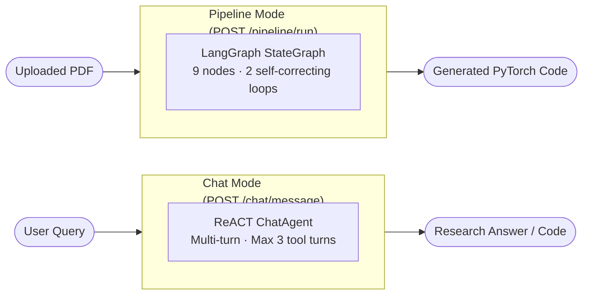

---

## 2. LangGraph Pipeline — Full Topology

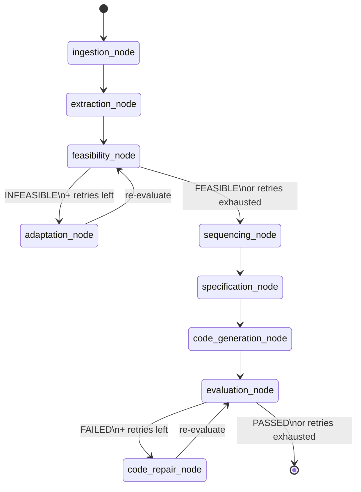

**Bounded loops:**
- Feasibility refinement: `max_feasibility_retries = 2`
- Code repair: `max_repair_retries = 2`

---

## 3. Telemetry Wrapper — Every Node

Every single node is wrapped by `wrap_node_with_telemetry()` before being registered in the graph. This is transparent to the node code itself.

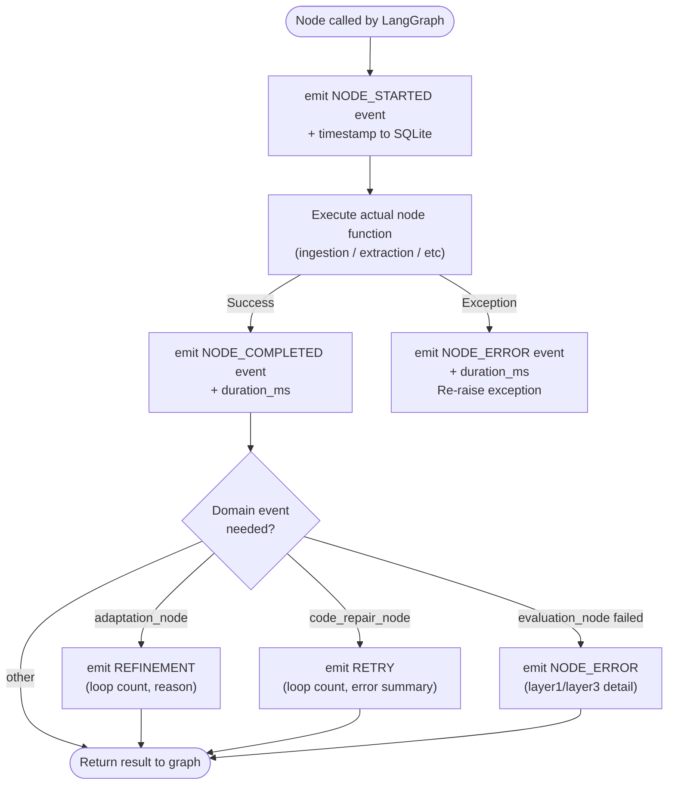

Events are consumed by the `GET /pipeline/jobs/{run_id}/events` **SSE stream** on the frontend.

---

## 4. Node-by-Node Breakdown

### 4.1 `ingestion_node` → `ingestion_agent.py`

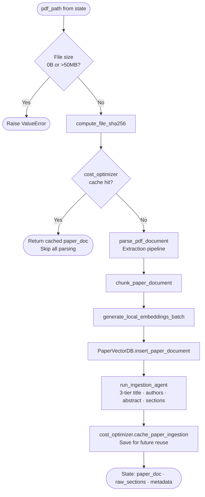

> **Cache hit** saves ~1250ms and thousands of embedding tokens for unchanged PDFs.

---

### 4.2 `extraction_node` → `parameter_agent` + `decomposition_agent`

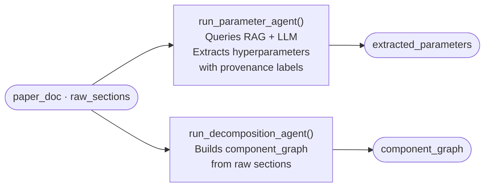

**Provenance levels for each extracted parameter:**

| Label | Meaning |
|---|---|
| `EXPLICIT` | Verbatim in paper text |
| `DERIVED` | Calculated from explicit values |
| `INFERRED` | Deduced from conventions |
| `ASSUMED` | ML default, paper silent |
| `UNKNOWN` | Not found (value = null) |

---

### 4.3 `feasibility_node` → `feasibility_agent.py`

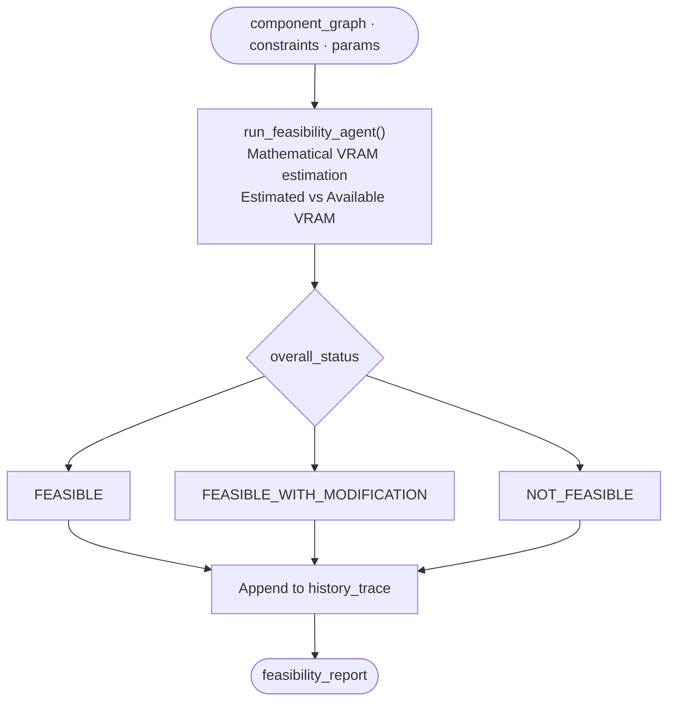

> Caches result if `loop_count == 0` and no forced recompute.

---

### 4.4 `adaptation_node` — Rule Engine (no LLM)

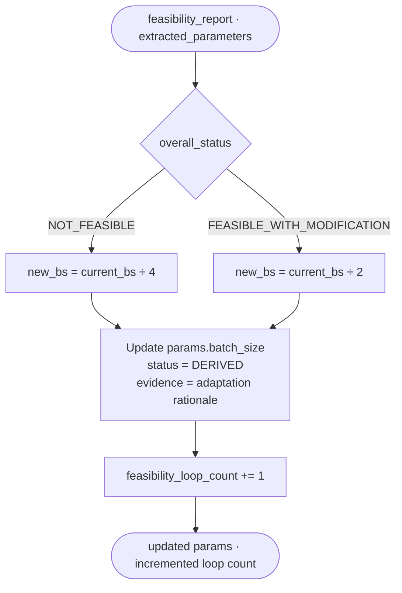

> Pure deterministic rule engine — no LLM call needed.

---

### 4.5 `sequencing_node` → `sequencing_agent` + `report_agent` + DAG validation

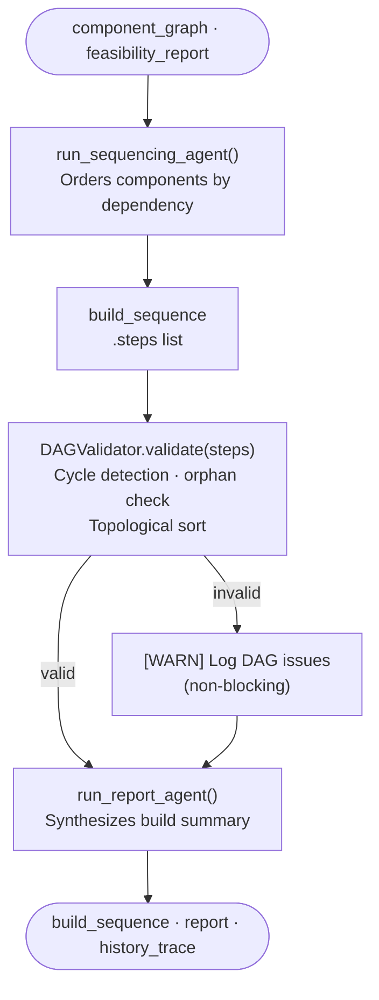

---

### 4.6 `specification_node` — Deterministic (no LLM)

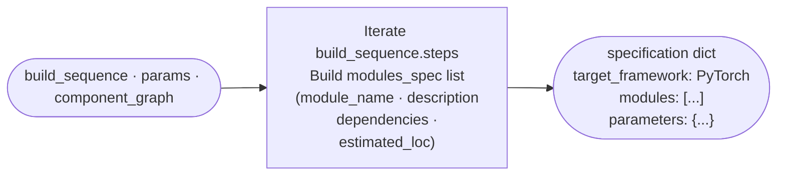

---

### 4.7 `code_generation_node` → `code_gen_agent.py`

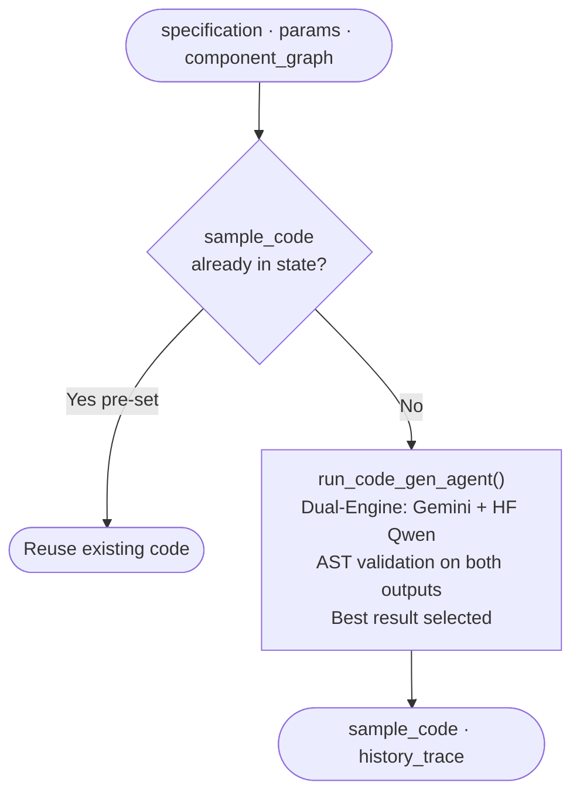

---

### 4.8 `evaluation_node` → `code_verifier.py`

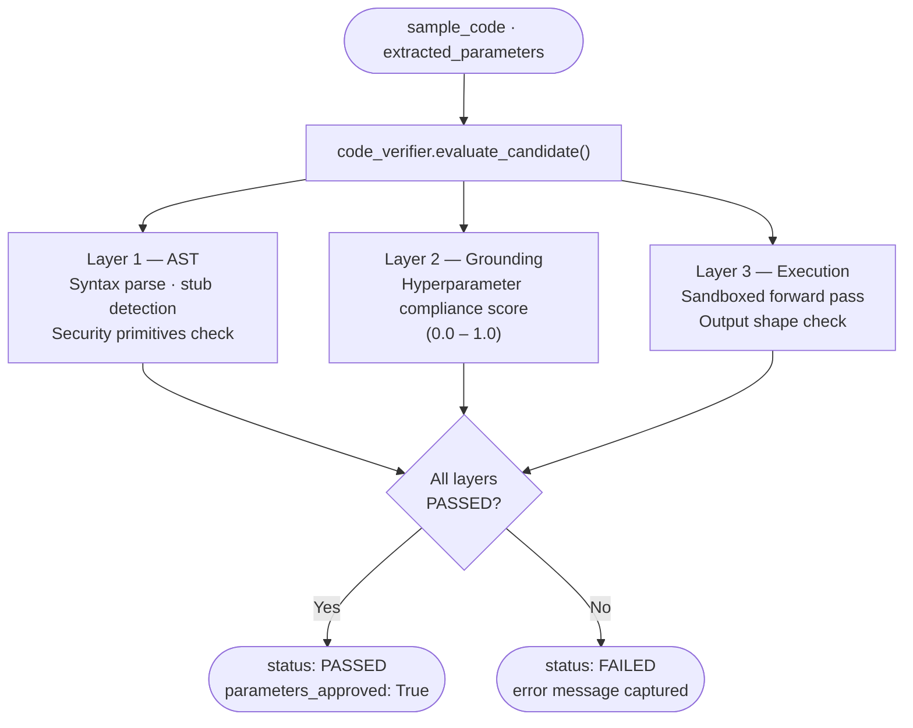

---

### 4.9 `code_repair_node` — Reflexion Loop

```mermaid
flowchart TD
    In([sample_code · verification_result.error]) --> H1{Missing super().__init__\nin nn.Module?}
    H1 -->|Yes| FX["Heuristic fix:\nInject super().__init__()"]
    H1 -->|No| LLM["Reflexion repair via ModelRouter\nbuild_reflexion_repair_prompt()\ntemperature = 0.2"]
    LLM -->|Repair OK| EC["extract_python_code()\nClean markdown fences"]
    LLM -->|LLM fails| ANN["Annotate original code\n# [REPAIR ATTEMPT N FAILED]"]
    FX & EC & ANN --> INC[code_repair_loop_count += 1]
    INC --> Out([repaired sample_code])
```

---

## 5. PipelineState — Shared Data Bus

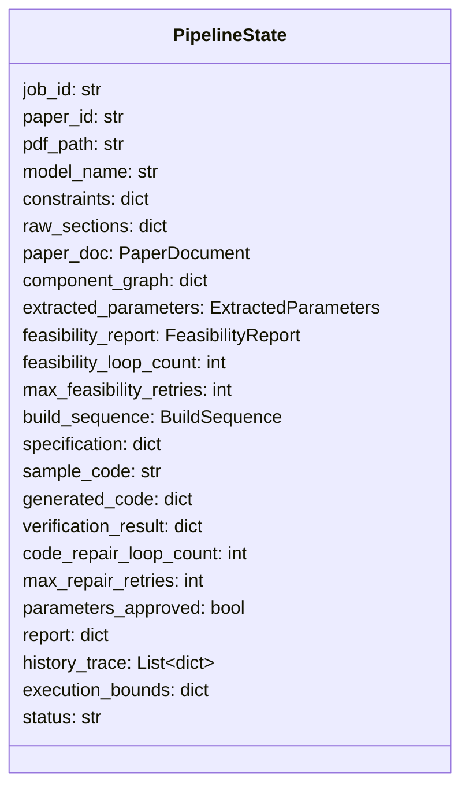

Every node reads from and writes back to this single typed dict — no global state, no side channels.

---

## 6. ChatAgent — ReACT Multi-Turn Loop

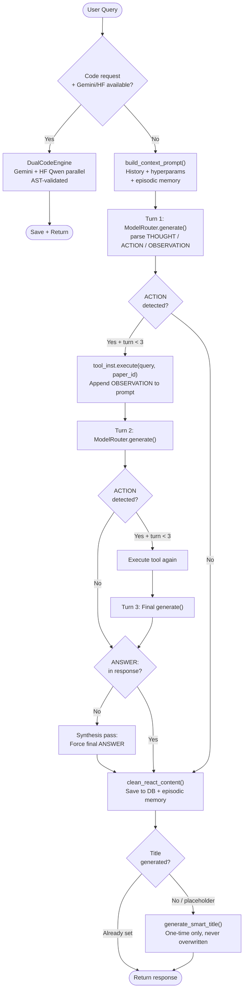

---

## 7. Tool Registry

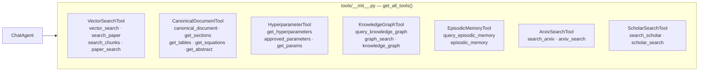

Each tool name has multiple **aliases** so the LLM can call it by any reasonable variation without failing.

---

## 8. Agent-to-Node Mapping

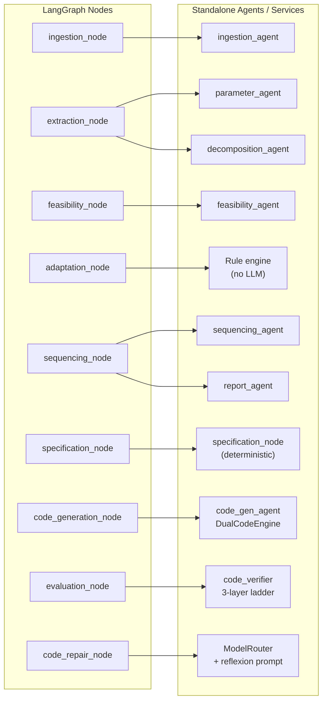

---

## 9. File Reference

| File | Role |
|---|---|
| `graph/workflow.py` | StateGraph build, telemetry wrapping, route functions |
| `graph/state.py` | `PipelineState` TypedDict |
| `graph/nodes/ingestion.py` | File validation, SHA-256 cache, parse + embed |
| `graph/nodes/extraction.py` | Delegates to `parameter_agent` + `decomposition_agent` |
| `graph/nodes/feasibility.py` | Delegates to `feasibility_agent`, history append |
| `graph/nodes/adaptation.py` | Rule-based batch size scaling, loop counter |
| `graph/nodes/sequencing.py` | DAG sequencing + validation + report synthesis |
| `graph/nodes/specification.py` | Deterministic spec dict from build sequence |
| `graph/nodes/code_generation.py` | Delegates to `code_gen_agent` / dual engine |
| `graph/nodes/evaluation.py` | Delegates to `code_verifier` 3-layer ladder |
| `graph/nodes/repair.py` | Heuristic fix → Reflexion LLM repair |
| `agents/chat_agent.py` | ReACT loop, dual-engine intercept, title generation |
| `agents/ingestion_agent.py` | 3-tier title/author/abstract/section extraction |
| `agents/parameter_agent.py` | Provenance-aware hyperparameter extraction |
| `agents/decomposition_agent.py` | Component graph building |
| `agents/feasibility_agent.py` | VRAM feasibility math |
| `agents/sequencing_agent.py` | Dependency-ordered build plan |
| `agents/report_agent.py` | Final report synthesis |
| `agents/code_gen_agent.py` | Dual-engine code synthesis invocation |
| `core/code_verifier.py` | 3-layer / 12-rung verification ladder |
| `core/dual_code_engine.py` | Gemini + HF Qwen parallel code engine |
| `core/dag_validator.py` | Topological sort, cycle detection |
| `core/events.py` | Typed event emitters + progress map + mascot map |
