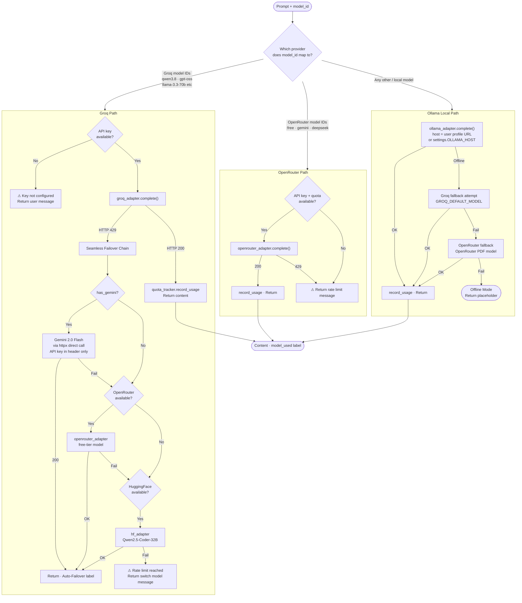
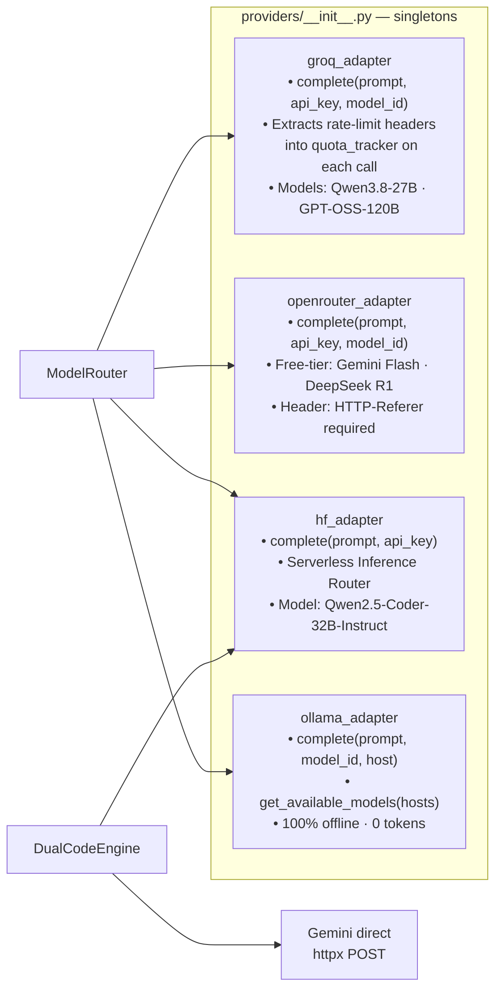
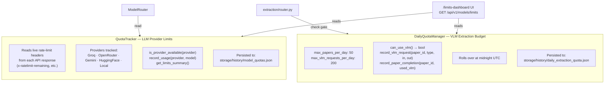
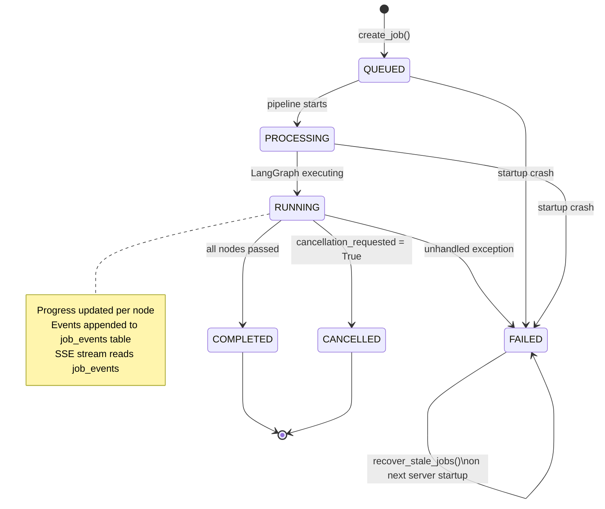
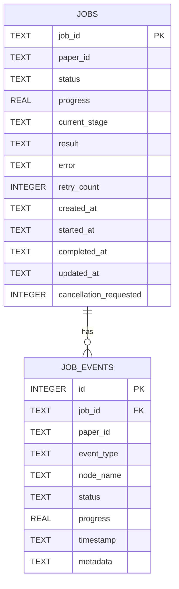
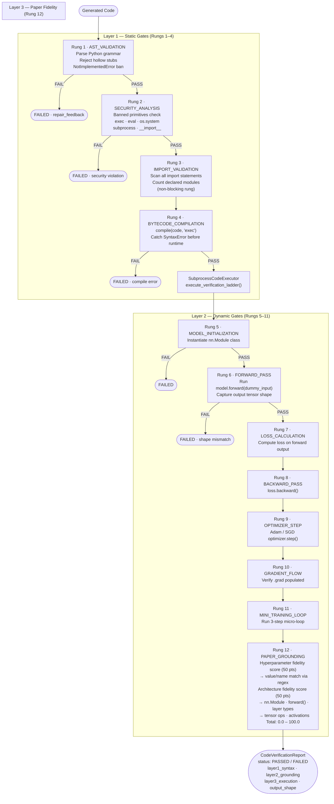
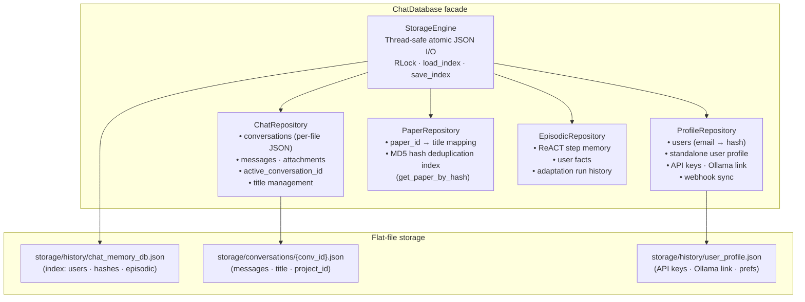
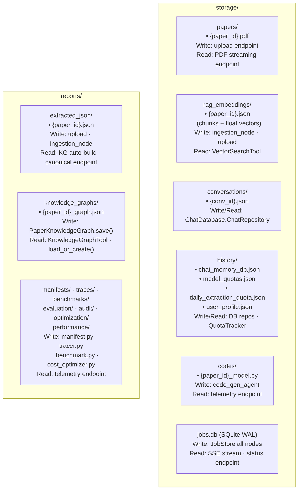
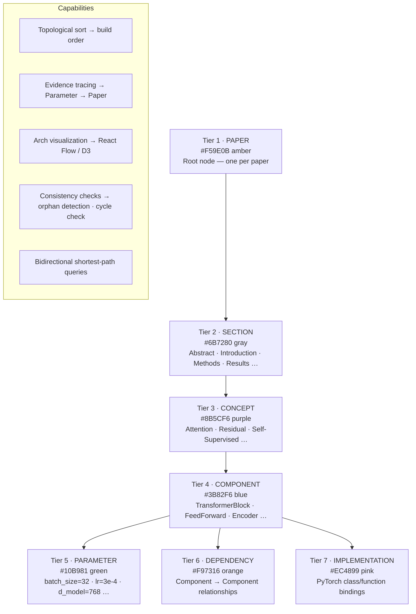

# Core Infrastructure — RUEXIS AI

> Covers: ModelRouter · Providers · Quota System · JobStore · CodeVerifier ·  
> API Surface · ChatDatabase · Storage Map

---

## 1. ModelRouter — Dispatch & Failover Chain

---

## 2. Provider Adapters

---

## 3. Dual-Layer Quota System

---

## 4. SQLite JobStore — State Machine

**SQLite schema (WAL mode, 2 tables):**

---

## 5. CodeVerifier — 12-Rung Ladder

---

## 6. API Endpoint Surface Map

```mermaid
flowchart LR
    subgraph Root["FastAPI root (main.py)"]
        R0["GET /  →  HTML dashboard or JSON\nGET /limits-dashboard  →  HTML\nGET /api/status  →  health JSON"]
    end

    subgraph Auth["/api/v1/auth"]
        A1["POST /auth/register\nPOST /auth/login\nGET  /auth/profile\nPUT  /auth/profile\nPOST /auth/profile/api-keys\nPOST /auth/profile/ollama-link"]
    end

    subgraph Papers["/api/v1/papers"]
        P1["POST /papers/upload  · upload PDF\nGET  /papers  · list all\nGET  /papers/{id}  · metadata\nGET  /papers/{id}/pdf  · stream PDF\nGET  /papers/{id}/canonical  · full doc\nDELETE /papers/{id}"]
    end

    subgraph Pipeline["/api/v1/pipeline"]
        PL1["POST /pipeline/run  · start job\nGET  /pipeline/jobs/{id}  · status\nGET  /pipeline/jobs/{id}/events  · SSE\nPOST /pipeline/jobs/{id}/cancel\nPOST /pipeline/approve  · approve params\nGET  /pipeline/stream/{id}  · alias SSE"]
    end

    subgraph Chat["/api/v1/conversations"]
        C1["GET  /conversations  · list all\nPOST /conversations  · create\nGET  /conversations/active  · current\nPOST /conversations/active  · set active\nPOST /conversations/{id}/chat  · message\nGET  /conversations/{id}/stream  · SSE chat\nDELETE /conversations/{id}\nPOST /conversations/{id}/facts  · user facts"]
    end

    subgraph Models["/api/v1/models"]
        M1["GET /models  · list all providers\nGET /models/limits  · live quota JSON\nGET /models/local  · Ollama models"]
    end

    subgraph HW["/api/v1/hardware"]
        H1["GET /hardware  · GPU/CPU probe"]
    end

    subgraph Tel["/api/v1/telemetry"]
        T1["GET /telemetry/benchmarks\nGET /telemetry/costs\nGET /telemetry/extraction\nGET /telemetry/evaluation"]
    end
```

---

## 7. ChatDatabase — Flat-File Repository Architecture

---

## 8. Storage Directory — Read/Write Map

---

## 9. Knowledge Graph — 7-Tier Hierarchy

---

## 10. File Reference

| File | Role |
|---|---|
| `core/model_router.py` | Multi-provider dispatch + 3-step Groq failover chain |
| `core/quota_tracker.py` | `QuotaTracker` (LLM limits) + `DailyQuotaManager` (VLM budget) |
| `core/job_store.py` | SQLite WAL job state machine + event log + stale recovery |
| `core/events.py` | `EventTypes` constants, progress map, mascot map, emitters |
| `core/code_verifier.py` | 3-layer / 12-rung verification ladder + sandbox executor |
| `core/dual_code_engine.py` | Parallel Gemini + HF Qwen code synthesis with AST validation |
| `core/database.py` | `ChatDatabase` facade over 4 JSON flat-file repositories |
| `core/cost_optimizer.py` | SHA-256 ingestion cache, prompt cache, token budgeting |
| `core/limits_dashboard.py` | HTML quota UI + `get_limits_json_payload()` |
| `core/dag_validator.py` | Topological sort, cycle detection, orphan check |
| `core/manifest.py` | Build manifest + SHA-256 file hashing |
| `core/tracer.py` | Append-only execution trace logger |
| `core/prompts.py` | All system/user prompt templates (centralized) |
| `core/config.py` | Settings singleton, directory auto-creation, API key gates |
| `core/security.py` | JWT creation/verification |
| `api/v1/api_router.py` | Aggregates all 7 sub-routers |
| `api/v1/endpoints/papers.py` | Paper upload, dedup, canonical, PDF stream |
| `api/v1/endpoints/pipeline.py` | Job orchestration, SSE stream |
| `api/v1/endpoints/chat.py` | Conversations CRUD, message dispatch, SSE chat |
| `api/v1/endpoints/models.py` | Model listing, live limits JSON |
| `api/v1/endpoints/auth.py` | JWT auth, profile, API key management |
| `api/v1/endpoints/hardware.py` | GPU/CPU probe |
| `api/v1/endpoints/telemetry.py` | Benchmark, cost, extraction, eval reports |
| `providers/groq_adapter.py` | Groq LPU REST client + header-based quota extraction |
| `providers/openrouter_adapter.py` | OpenRouter free-tier client |
| `providers/hf_adapter.py` | HF Serverless Inference Router client |
| `providers/ollama_adapter.py` | Local Ollama client + model discovery |
| `retrieval/knowledge_graph.py` | 7-tier NetworkX DiGraph + save/load/query |
