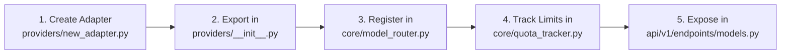

# Developer Extension & Contributing Guide

> Practical developer guide detailing extension recipes for adding new LLM providers, agent tools, frontend state slices, and native IPC channels in **RUEXIS AI (v2.0)**.

---

## 1. Architectural Rules for Contributors

When extending RUEXIS AI, follow these core conventions:

1. **Strict Storage Separation:**
   * Runtime caches, session databases, and temporary uploads go in `storage/`.
   * User-facing final deliverables, manifests, synthesized codebases, and evaluation logs go in `reports/`.
2. **Never Block on Long-Running Agent Tasks:**
   * Heavy extraction, synthesis, and LangGraph operations must be dispatched as asynchronous background jobs via `JobStore`.
   * Progress and telemetry must always be broadcast via the Server-Sent Events (SSE) stream (`/api/v1/pipeline/jobs/{id}/events`).
3. **Resilient Provider Fallbacks:**
   * Any new external model provider integration must include error handling and fallbacks in `ModelRouter` to prevent runtime crashes when external APIs hit rate limits (HTTP 429).

---

## 2. Recipe: Adding a New LLM Provider

To integrate a new LLM provider (e.g., Anthropic, Mistral, or a custom self-hosted vLLM instance):



### Step 1: Create the Provider Adapter
Create `backend/app/providers/custom_adapter.py`:
```python
import httpx
from typing import Optional

class CustomAdapter:
    def __init__(self):
        self.endpoint = "https://api.custom-provider.com/v1/chat/completions"

    async def complete(self, prompt: str, api_key: str, model_id: str) -> str:
        headers = {"Authorization": f"Bearer {api_key}"}
        payload = {
            "model": model_id,
            "messages": [{"role": "user", "content": prompt}]
        }
        async with httpx.AsyncClient(timeout=30.0) as client:
            response = await client.post(self.endpoint, headers=headers, json=payload)
            response.raise_for_status()
            data = response.json()
            return data["choices"][0]["message"]["content"]

custom_adapter = CustomAdapter()
```

### Step 2: Register in `backend/app/providers/__init__.py`
```python
from app.providers.custom_adapter import custom_adapter
```

### Step 3: Register in `ModelRouter` & `QuotaTracker`
* In `backend/app/core/model_router.py`, add the provider mapping and failover chain entry.
* In `backend/app/core/quota_tracker.py`, register the provider name in `QuotaTracker.is_provider_available()`.

---

## 3. Recipe: Adding a New Agent Tool

Agent tools allow LangGraph agents and the ReACT chat agent to interact with external APIs, databases, or local code execution environments.

### Step 1: Create the Tool Function
Create `backend/app/tools/custom_tool.py`:
```python
from langchain_core.tools import tool

@tool
def calculate_paper_impact(citation_count: int, year: int) -> dict:
    """Calculates an estimated impact velocity score based on citations and publication year."""
    years_active = max(1, 2026 - year)
    velocity = round(citation_count / years_active, 2)
    return {
        "velocity": velocity,
        "impact_tier": "high" if velocity > 50 else "moderate" if velocity > 10 else "emerging"
    }
```

### Step 2: Register in `backend/app/tools/__init__.py`
Add the new tool to `get_all_tools()`:
```python
from app.tools.custom_tool import calculate_paper_impact

def get_all_tools():
    return [
        # ... existing tools ...
        calculate_paper_impact
    ]
```

### Step 3: Test Tool Execution
Add a unit test in `backend/tests/test_tools.py`:
```python
def test_calculate_paper_impact():
    from app.tools.custom_tool import calculate_paper_impact
    res = calculate_paper_impact.invoke({"citation_count": 100, "year": 2024})
    assert res["velocity"] == 50.0
```

---

## 4. Recipe: Adding a New Frontend State Slice

The React 19 UI uses Zustand with a modular slice pattern.

### Step 1: Define the Slice Interface & Creator
Create `frontend/renderer/src/store/slices/customFeatureSlice.ts`:
```typescript
import { StateCreator } from 'zustand';

export interface CustomFeatureSlice {
  featureEnabled: boolean;
  selectedMetric: string;
  setFeatureEnabled: (enabled: boolean) => void;
  setSelectedMetric: (metric: string) => void;
}

export const createCustomFeatureSlice: StateCreator<CustomFeatureSlice> = (set) => ({
  featureEnabled: false,
  selectedMetric: 'latency',
  setFeatureEnabled: (enabled) => set({ featureEnabled: enabled }),
  setSelectedMetric: (metric) => set({ selectedMetric: metric }),
});
```

### Step 2: Combine in `frontend/renderer/src/store/panelStore.ts`
Import and spread the slice into the composite store:
```typescript
import { CustomFeatureSlice, createCustomFeatureSlice } from './slices/customFeatureSlice';

export type PanelState = ExistingSlices & CustomFeatureSlice;

export const usePanelStore = create<PanelState>()((...a) => ({
  ...createExistingSlices(...a),
  ...createCustomFeatureSlice(...a),
}));
```

### Step 3: Consume in UI Components
```tsx
import { usePanelStore } from '../store/panelStore';

export const MetricSelector = () => {
  const metric = usePanelStore((s) => s.selectedMetric);
  const setMetric = usePanelStore((s) => s.setSelectedMetric);

  return (
    <select value={metric} onChange={(e) => setMetric(e.target.value)}>
      <option value="latency">Latency</option>
      <option value="tokens">Token Usage</option>
    </select>
  );
};
```

---

## 5. Recipe: Adding a New Native IPC Channel

To communicate between the React sidebar panel and the Electron main process:

### Step 1: Add Main Process Listener
In `frontend/electron_app/src/main.js`:
```javascript
ipcMain.handle('custom-native-action', async (event, payload) => {
    console.log("[Main Process] Handling custom action:", payload);
    // Perform OS or window operation
    return { success: true, timestamp: Date.now() };
});
```

### Step 2: Expose in Preload Bridge
In `frontend/electron_app/src/preload.js`:
```javascript
contextBridge.exposeInMainWorld('mascotAPI', {
    // ... existing channels ...
    executeCustomAction: (payload) => {
        return ipcRenderer.invoke('custom-native-action', payload);
    }
});
```

### Step 3: Call from React Component
```typescript
const handleAction = async () => {
  if (window.mascotAPI?.executeCustomAction) {
    const res = await window.mascotAPI.executeCustomAction({ foo: 'bar' });
    console.log("Action response:", res);
  }
};
```

---

## 6. Pre-Commit Verification Checklist

Before submitting code changes or opening a pull request, run the following verification steps:

```powershell
# 1. Backend Verification
cd backend
python -m pytest tests/ -q

# 2. Frontend Type & Build Verification
cd ../frontend/renderer
npm run typecheck
npm run lint
npm run build

# 3. Electron Native Verification
cd ../electron_app
npm run rebuild
```

### Pull Request Guidelines
* Keep PRs focused on a single feature or bugfix.
* Include corresponding unit tests in `backend/tests/` for new backend logic.
* Do not commit `.env`, `storage/papers/*.pdf`, or local database files.
* Adhere to existing naming conventions (e.g. snake_case in Python, camelCase in TypeScript).
