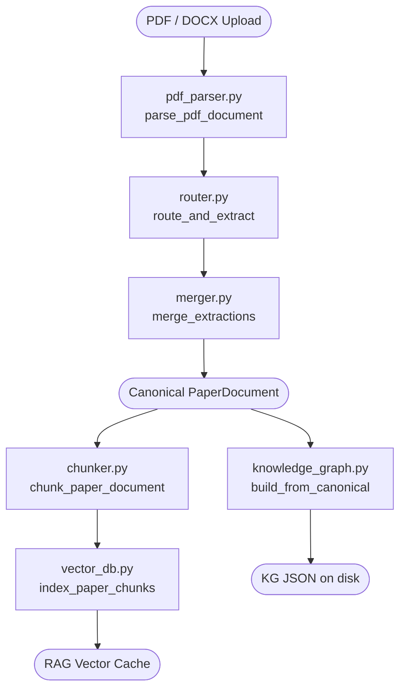
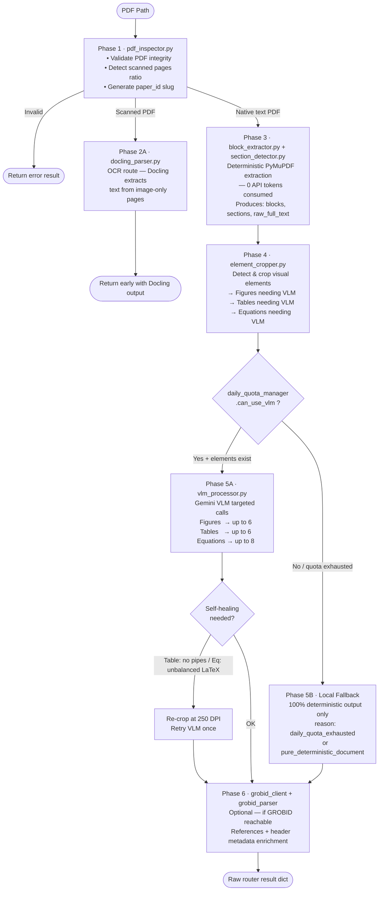
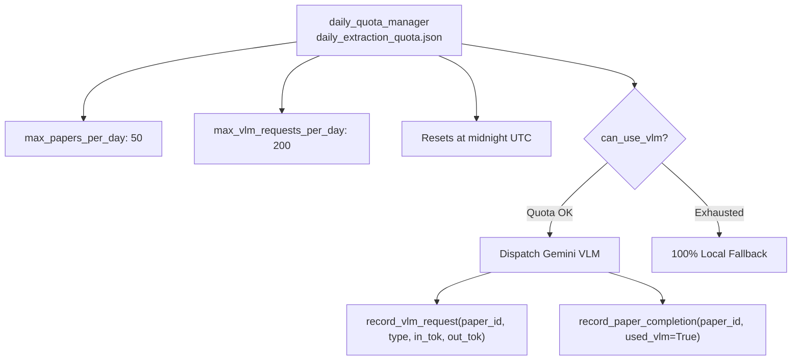
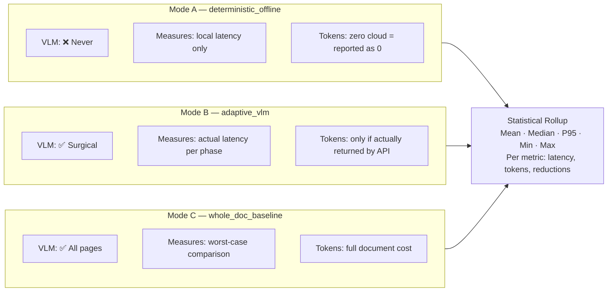
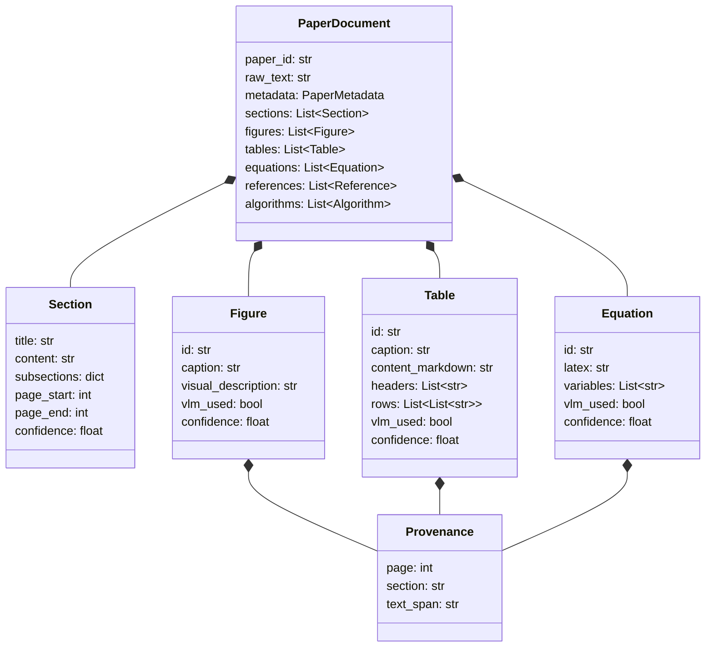
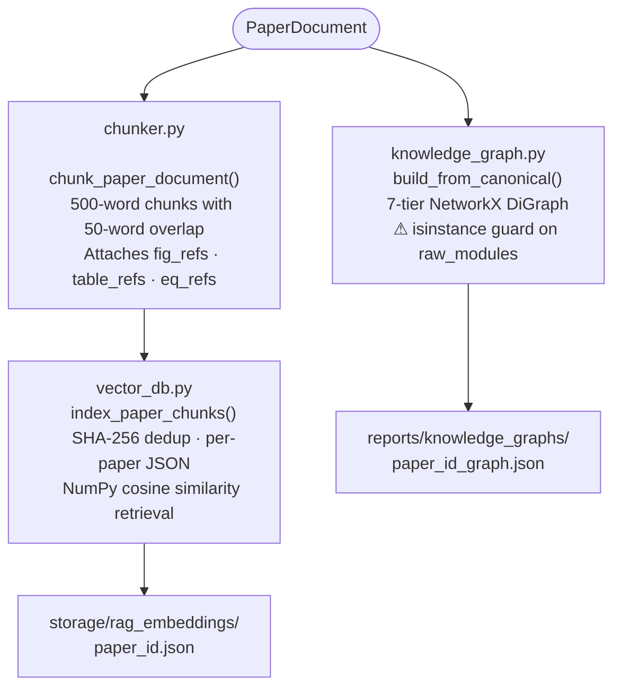

# Extraction Pipeline — RUEXIS AI

> Covers all files under `backend/app/extraction/` plus the retrieval layer that consumes its output.

---

## 1. High-Level Flow



---

## 2. Inside `router.py` — Phase-by-Phase



---

## 3. Inside `merger.py` — Consensus Assembly

```mermaid
flowchart LR
    subgraph Inputs
        A1[PyMuPDF output\nsections · raw text]
        A2[VLM output\nfigures · tables · equations]
        A3[GROBID output\nreferences · metadata]
        A4[Docling output\nOCR text · tables]
    end

    subgraph Merger["merger.py — merge_extractions()"]
        direction TB
        M1["extract_consensus_tables()
        Priority: VLM > Docling > PyMuPDF
        ⚠ isinstance(data, dict) guard"]
        M2["extract figures
        Priority: VLM > PyMuPDF caption"]
        M3["extract equations
        Priority: VLM LaTeX > PyMuPDF text"]
        M4["extract sections
        Always: PyMuPDF (deterministic)"]
        M5["extract abstract
        Priority: GROBID > Docling
        ⚠ isinstance guard"]
        M6["extract references
        Priority: GROBID > Docling
        ⚠ isinstance guard per item"]
        M7["extract metadata
        Priority: GROBID > Docling > PyMuPDF"]
    end

    Inputs --> Merger
    Merger --> Out([PaperDocument])
```



> **Why the `isinstance` guards?**  
> Parsers like Grobid/Docling return a raw `str` when they partially fail (e.g., no XML response).  
> Calling `.get()` on a `str` raises `AttributeError`. Every parser output is now guarded:
> ```python
> if isinstance(data, dict) and data.get("tables"):
>     ...
> ```

---

## 4. VLM Quota System



---

## 5. Benchmark Modes — `benchmark.py`



---

## 6. Canonical Schema — What Extraction Produces



---

## 7. Retrieval Consumers



---

## 8. File Reference

| File | Role |
|---|---|
| `extraction/pdf_parser.py` | Public entry — calls router then merger |
| `extraction/router.py` | Phase orchestrator — Deterministic-First logic |
| `extraction/merger.py` | Multi-parser consensus assembler |
| `extraction/benchmark.py` | A/B/C mode benchmark suite |
| `extraction/validator.py` | Post-merge quality check |
| `extraction/pdf_inspector.py` | PDF metadata + scanned page detection |
| `extraction/block_extractor.py` | PyMuPDF layout block extraction |
| `extraction/section_detector.py` | Heading hierarchy detection |
| `extraction/element_cropper.py` | Visual element detection & image cropping |
| `extraction/vlm_processor.py` | Gemini VLM transcription (figures/tables/eq) |
| `extraction/pymupdf_parser.py` | PyMuPDF text + structure parsing |
| `extraction/grobid_parser.py` | GROBID XML reference/header parsing |
| `extraction/grobid_client.py` | GROBID REST client |
| `extraction/docling_parser.py` | Docling OCR path for scanned PDFs |
| `extraction/semantic_analyzer.py` | NLP section classification |
| `extraction/constants.py` | DPI settings, detection thresholds |
| `retrieval/chunker.py` | Provenance-aware RAG chunker |
| `retrieval/vector_db.py` | Local flat-file vector store |
| `retrieval/knowledge_graph.py` | 7-level NetworkX KG service |
| `retrieval/embeddings.py` | Embedding model adapter |
| `core/quota_tracker.py` | `daily_quota_manager` — VLM budget enforcement |
