# 🎨 Frontend Architecture & Implementation — RUEXIS AI (Marginalia)

> Technical guide covering the Dual-Window Electron system, HTML5 Canvas Sprite Engine, React 19 + TypeScript control panel, Zustand slice architecture, and real-time SSE telemetry integration.

---

## 1. High-Level Architecture & Runtime Modes

RUEXIS AI's frontend operates in two primary modes:
1. **Desktop Native (Dual-Window Electron):** An unconstrained, frameless canvas overlay hosts the interactive mascot (*Mr. Nerdy*) floating above the OS desktop, lockstep-aligned with a dedicated slide-out React sidebar control panel.
2. **Browser Development (Vite HMR):** The React control panel runs standalone in the browser, interfacing directly with the FastAPI backend at `http://localhost:8000/api/v1`.

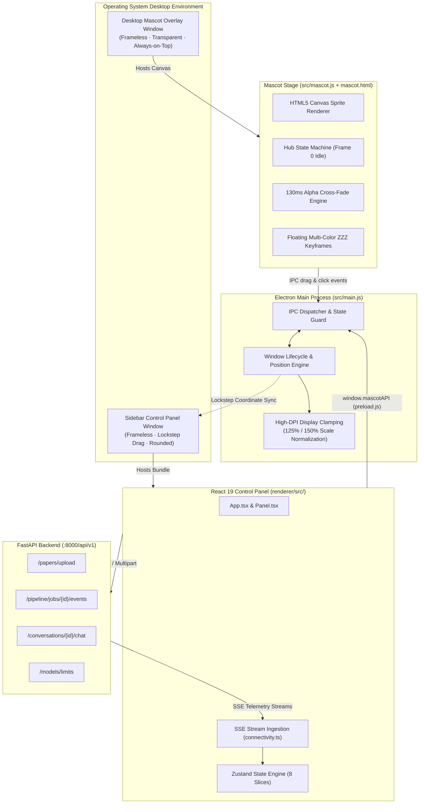

---

## 2. Electron Main Process & Native IPC Bridge

The Electron layer (`frontend/electron_app/src/main.js` and `preload.js`) coordinates multi-window positioning, High-DPI display scaling, and secure inter-process communication without exposing raw Node.js primitives to the renderer.

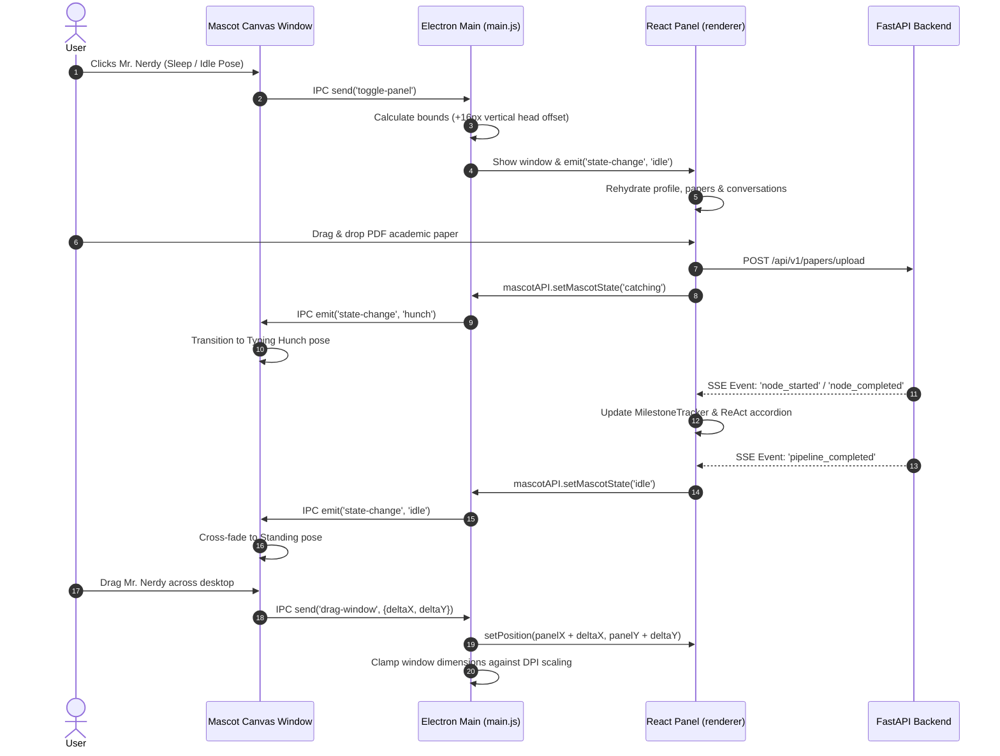

### Preload IPC API Surface (`window.mascotAPI`)

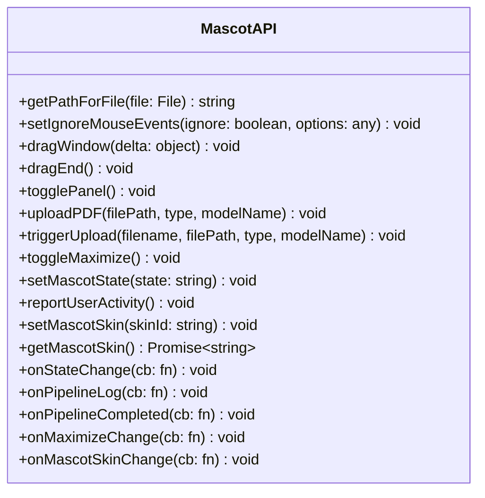

---

## 3. Mascot Canvas Sprite Engine (`mascot.js`)

The mascot engine renders animated sprite strips using an HTML5 Canvas without framework overhead. Transitions between different emotional states flow through a **Hub Pose State Machine** centered on Frame `0` of the idle pose.

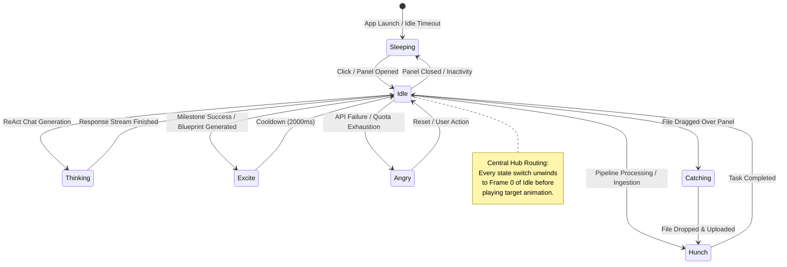

### Cross-Fading & State Queue Pipeline

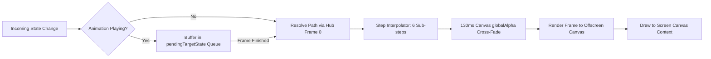

---

## 4. React Control Panel Layout Hierarchy

The React application entry point is `App.tsx`, which mounts `Panel.tsx`. The interface adapts between a **compact floating drawer (340x480)** and a **maximized full-screen IDE dashboard (1400x900)**.

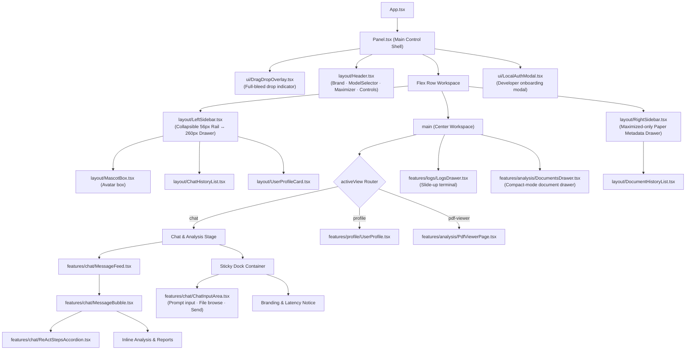

---

## 5. Feature Modules Deep Dive

### 5.1 Chat & ReAct Stream Processing

When chatting with the assistant, incoming reasoning traces containing `<thought>`, `Action:`, and `Observation:` blocks are parsed on the fly.

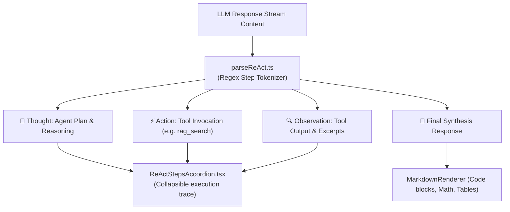

### 5.2 Analysis & Pipeline Feature Stack

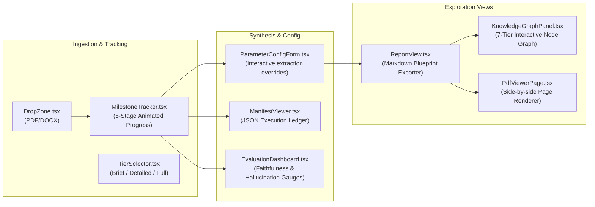

---

## 6. Zustand Store Architecture (Slice Pattern)

The frontend consolidates all reactive application state in `usePanelStore` using Zustand's slice composition pattern, complemented by standalone stores for terminal logs and themes.

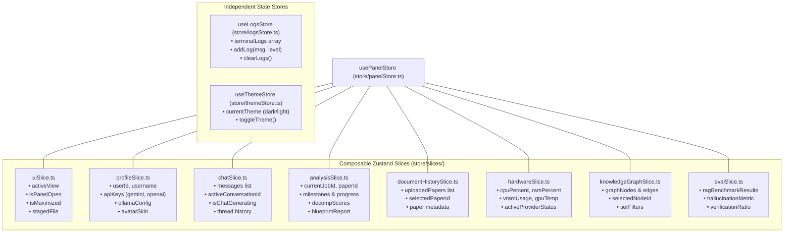

---

## 7. Real-Time Telemetry & Backend Integration

The communication service layer (`renderer/src/services/connectivity.ts`) and API configuration (`renderer/src/config/api.ts`) handle REST operations and consume Server-Sent Events (SSE).

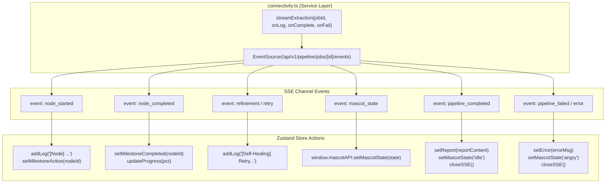

---

## 8. Theme System & Design Tokens

Tailwind v4 tokens in `renderer/src/index.css` define an academic, archival aesthetic:

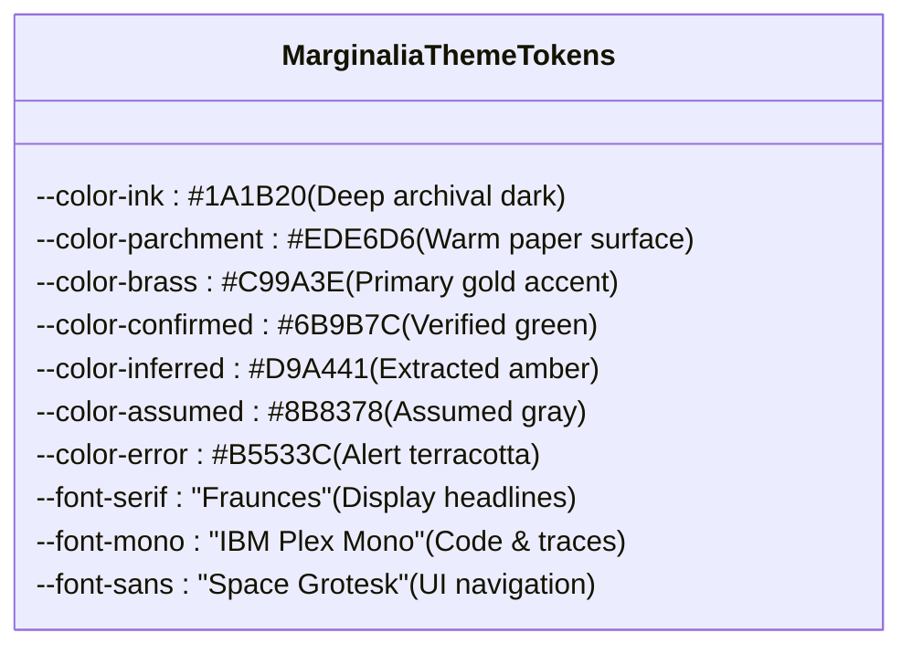

---

## 9. Comprehensive Frontend File Reference Table

### Electron Main Process & Mascot Canvas (`frontend/electron_app/`)

| File Path | Description | Tech Stack |
|---|---|---|
| `electron_app/src/main.js` | Electron main process: manages dual-window lifecycle, DPI scaling clamp, lockstep drag coordinates, and IPC event dispatching. | Node.js / Electron |
| `electron_app/src/preload.js` | Secure preload script exposing `window.mascotAPI` methods to the renderer context via `contextBridge`. | Electron ContextBridge |
| `electron_app/src/mascot.js` | High-performance HTML5 Canvas sprite engine with hub state machine, 130ms alpha cross-fading, and event queues. | Vanilla JS / Canvas 2D |
| `electron_app/src/mascot.html` | Frameless window container DOM hosting the sprite canvas and floating ZZZ particles. | HTML5 |
| `electron_app/src/mascot.css` | Transparent canvas positioning, cursor styling, and multi-color ZZZ keyframe animations. | CSS3 Keyframes |
| `electron_app/src/mascot_transitions.json`| Sprite frame coordinates, animation timing curves, and state transition maps. | JSON Schema |
| `electron_app/src/assets/` | Transparent PNG sprite strips for Mr. Nerdy poses (`stand_sleep`, `stand_to_hunch`, `stand_to_angry`, etc.). | Asset Directory |

### React Sidebar Control Panel (`frontend/renderer/src/`)

| File Path | Description | Tech Stack |
|---|---|---|
| `renderer/src/main.tsx` | React 19 entrypoint mounting `App.tsx` into the root DOM element. | React 19 / TSX |
| `renderer/src/App.tsx` | Top-level container providing root theme classes and rendering `Panel.tsx`. | React / TSX |
| `renderer/src/index.css` | Tailwind v4 configuration, font imports (Fraunces, Space Grotesk, IBM Plex Mono), theme variables, and custom scrollbars. | CSS3 / Tailwind v4 |
| `renderer/src/config/api.ts` | Dynamic API URL resolver and endpoint constant catalog (supports Electron `localhost:8000` & Vite dev mode). | TypeScript |
| `renderer/src/services/connectivity.ts`| Backend communications service: handles REST calls and manages SSE EventSource listeners. | TypeScript / Fetch / SSE |
| `renderer/src/constants/branding.ts` | Product brand strings, disclaimer notices, and mascot naming constants. | TypeScript |
| `renderer/src/constants/models.ts` | Default catalog of supported LLM / VLM engines, context limits, and routing tier tags. | TypeScript |
| `renderer/src/utils/markdownParser.tsx` | Custom markdown renderer supporting code syntax highlighting, math formulas, and tables. | React / TSX |
| `renderer/src/utils/formatters.ts` | Formatting helpers for file sizes, timestamps, execution runtimes, and confidence percentages. | TypeScript |

### Layout Components (`renderer/src/components/layout/`)

| File Path | Description | Tech Stack |
|---|---|---|
| `components/layout/Header.tsx` | Unified top bar hosting brand icon, ModelSelector dropdown, theme switch, log drawer toggle, and window controls. | React / TSX |
| `components/layout/LeftSidebar.tsx` | Collapsible sidebar: toggles between 56px icon rail and 260px expanded drawer with chat threads and paper history. | React / TSX |
| `components/layout/RightSidebar.tsx` | Maximized-mode slide-out drawer presenting detailed paper metadata, citation badges, and document attributes. | React / TSX |
| `components/layout/MascotBox.tsx` | Interactive companion card showing active skin, animated pulse indicator, and mood status badge. | React / TSX |
| `components/layout/ChatHistoryList.tsx` | Interactive list of active and archived conversation threads with rename and delete options. | React / TSX |
| `components/layout/DocumentHistoryList.tsx`| Ingested paper ledger with decomposition scores, parameter certainty gauges, and delete actions. | React / TSX |
| `components/layout/UserProfileCard.tsx` | Compact user profile chip displaying developer avatar, username, and local status. | React / TSX |
| `components/layout/CompactHistoryDropdown.tsx`| Minimized-mode quick switcher for jumping between past analysis sessions. | React / TSX |

### Feature Modules (`renderer/src/components/features/`)

| File Path | Description | Tech Stack |
|---|---|---|
| `components/panel/Panel.tsx` | Core container coordinating layout panes, drag-and-drop ingestion, view routing, and IPC rehydration. | React / TSX |
| `features/chat/MessageFeed.tsx` | Infinite-scrolling conversation feed with auto-scroll and message role segmentation. | React / TSX |
| `features/chat/MessageBubble.tsx` | Chat speech bubble rendering Markdown, inline attachments, ReAct accordions, and model attribution chips. | React / TSX |
| `features/chat/ChatInputArea.tsx` | Auto-expanding textarea with file attachment staging, model selector triggers, and keyboard shortcuts. | React / TSX |
| `features/chat/parseReAct.ts` | Regex tokenizer isolating thoughts, actions, and observations from streaming responses. | TypeScript |
| `features/chat/ReActStepsAccordion.tsx` | Expandable disclosure UI presenting agent reasoning steps, tool queries, and raw observations. | React / TSX |
| `features/analysis/DropZone.tsx` | Drag-and-drop zone with animated scanline styling for PDF/DOCX paper ingestion. | React / TSX |
| `features/analysis/MilestoneTracker.tsx` | Animated 5-step milestone pipeline visualizer showing real-time backend agent progress. | React / TSX |
| `features/analysis/ReportView.tsx` | Rich blueprint proposal reader with copy-to-clipboard, export buttons, and section jumps. | React / TSX |
| `features/analysis/ParameterConfigForm.tsx`| Interactive form allowing manual tuning and overrides of extracted hyper-parameters. | React / TSX |
| `features/analysis/EvaluationDashboard.tsx`| RAG benchmark analytics dashboard with radar graphs, hallucination rates, and faithfulness scores. | React / TSX |
| `features/analysis/KnowledgeGraphPanel.tsx`| Interactive 7-tier knowledge graph visualizing entities, dependencies, and methods extracted from the paper. | React / TSX / Canvas |
| `features/analysis/ManifestViewer.tsx` | Structured JSON inspection viewer for reviewing the execution ledger and node timestamps. | React / TSX |
| `features/analysis/PdfViewerPage.tsx` | Side-by-side embedded PDF reader with jump-to-page and section highlighter. | React / TSX |
| `features/analysis/DocumentsDrawer.tsx` | Slide-up drawer for accessing previously processed papers in compact view mode. | React / TSX |
| `features/logs/LogsDrawer.tsx` | Expandable terminal console displaying live backend execution logs, log levels, and clear controls. | React / TSX |
| `features/profile/UserProfile.tsx` | Developer profile dashboard for managing API keys, Ollama endpoints, quota gauges, and mascot skins. | React / TSX |
| `features/profile/ApiKeysConfigSection.tsx`| Form for verifying and storing Gemini, OpenAI, Anthropic, and Groq API tokens. | React / TSX |
| `features/profile/OllamaConfigSection.tsx` | Local inference connectivity validator checking status, models, and latency of Ollama instances. | React / TSX |
| `features/profile/ModelLimitsSection.tsx` | Daily quota usage meters showing remaining calls and resets for cloud providers. | React / TSX |
| `features/profile/MascotSelector.tsx` | Visual skin picker for switching between mascot avatars (Mr. Nerdy, Robo, etc.). | React / TSX |

### State Management Stores (`renderer/src/store/`)

| File Path | Description | Tech Stack |
|---|---|---|
| `store/panelStore.ts` | Central Zustand store assembling all 8 feature slices into a single unified reactive state hook. | Zustand / TS |
| `store/slices/uiSlice.ts` | Manages view state (`chat`, `profile`, `pdf-viewer`), modal visibility, sidebar states, and staged files. | Zustand Slice |
| `store/slices/chatSlice.ts` | Manages messages, active conversation ID, chat generation state, and message dispatch. | Zustand Slice |
| `store/slices/analysisSlice.ts` | Manages job lifecycle, pipeline milestones, decomposition certainty scores, and blueprint reports. | Zustand Slice |
| `store/slices/profileSlice.ts` | Manages user credentials, API keys, Ollama configuration, and active mascot avatar. | Zustand Slice |
| `store/slices/documentHistorySlice.ts`| Manages paper document ledger, search filtering, and active document selection. | Zustand Slice |
| `store/slices/hardwareSlice.ts` | Manages real-time telemetry: CPU, RAM, GPU VRAM, temperature, and backend provider health. | Zustand Slice |
| `store/slices/knowledgeGraphSlice.ts`| Manages knowledge graph node filters, active entity selection, and tier visibility. | Zustand Slice |
| `store/slices/evalSlice.ts` | Manages RAG evaluation benchmarks, faithfulness scores, and hallucination metrics. | Zustand Slice |
| `store/logsStore.ts` | Independent store for real-time terminal logs with log level filtering and capacity limits. | Zustand |
| `store/themeStore.ts` | Independent store tracking light/dark themes and persisting preferences to `localStorage`. | Zustand |
