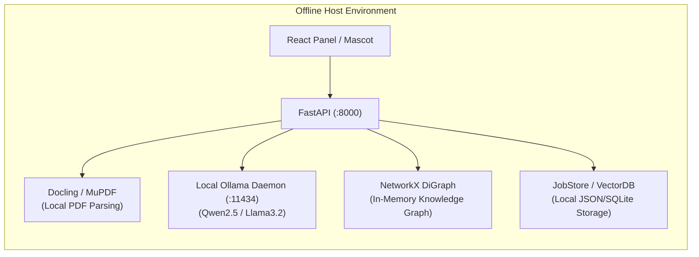

# Packaging & Production Deployment Guide

> Operational guide for packaging, distributing, and deploying **RUEXIS AI (v2.0)** as a standalone desktop application with an integrated Python backend, native Win32 desktop overlays, and offline capabilities.

---

## 1. Architecture: Development vs. Packaged Production

RUEXIS AI operates differently in development vs. packaged desktop production:

```mermaid
flowchart TD
    subgraph DevMode ["Development Mode"]
        D1["Vite Dev Server (:5173)\nHot Module Replacement"]
        D2["FastAPI Server (:8000)\nUvicorn Auto-reload"]
        D3["Electron Window\nLoads http://localhost:5173"]
        D3 -->|HTTP/SSE| D2
        D3 -->|HMR| D1
    end

    subgraph ProdMode ["Packaged Desktop Production"]
        P1["Bundled React Assets\nfile:// .../renderer/dist/index.html"]
        P2["Local Python Runtime\nSpawned by Electron main.js"]
        P3["Electron Container (app.isPackaged = true)\nFrameless Native Win32 Windows"]
        P3 -->|Loads Local Bundle| P1
        P3 -->|Spawns Subprocess| P2
        P1 -->|Local REST/SSE (:8000)| P2
    end
```

### Key Differences in Production

| Aspect | Development Mode | Packaged Production Mode |
|---|---|---|
| **Renderer Origin** | `http://localhost:5173` | `file://.../renderer/dist/index.html` or `app://.` |
| **CORS Access** | Whitelisted loopback origins | Origin `app://.` and `file://` enabled in `backend/main.py` |
| **Backend Lifecycle** | Started manually in separate terminal | Electron `main.js` automatically spawns `backend/main.py` |
| **Native Modules** | Loaded directly from `node_modules/` | Unpacked from `.asar` into `app.asar.unpacked/` |
| **API Base URL** | Dynamically resolved via `src/config/api.ts` | Always targets `http://localhost:8000/api/v1` |

---

## 2. Step 1: Build the Production Renderer

Before packaging the Electron desktop shell, compile the React 19 + TypeScript application into static distribution assets:

```powershell
cd frontend/renderer

# 1. Type-check to ensure zero TypeScript errors
npm run typecheck

# 2. Build production bundle via Vite
npm run build
```

* **Output Directory:** `frontend/renderer/dist/`
* **Artifacts Created:**
  * `dist/index.html` — Entry document
  * `dist/assets/index-[hash].js` — Minified React + Zustand bundle
  * `dist/assets/index-[hash].css` — Compiled Tailwind v4 stylesheet

Verify the build can be previewed:
```powershell
npm run preview
# → Starts local preview server at http://localhost:4173
```

---

## 3. Step 2: Electron Packaging with `electron-builder`

Electron packaging uses `electron-builder` configured in [frontend/electron_app/package.json](../frontend/electron_app/package.json).

### Pack Directory (Fast Local Test)

Compiles the Electron binary and packages all files into a directory without creating an installer. Ideal for testing whether native FFI modules load properly:

```powershell
cd frontend/electron_app

# Generates unpacked directory in dist_electron/win-unpacked/
npm run pack
```

### Build Full NSIS Installer (`.exe`)

Generates a standalone Windows installer suitable for end users:

```powershell
cd frontend/electron_app

# Generates NSIS installer in dist_electron/
npm run dist
```

---

## 4. Native Modules Handling (`koffi` & `active-win`)

RUEXIS AI relies on two native C/C++ modules in the Electron main process:
1. **`koffi`:** Fast Win32 FFI calling `shell32.dll` for `SHAppBarMessage` (taskbar boundary detection).
2. **`active-win`:** Context-aware window monitoring for automated paper-reading mode.

### Why `.asar` Unpacking is Required
Native modules contain compiled `.node` C++ dynamic libraries (`.dll` on Windows). The OS loader cannot execute `.node` binaries directly from inside an archived `.asar` file.

To ensure native modules function in the packaged app, verify the `build` configuration in `frontend/electron_app/package.json` includes:

```json
"build": {
  "appId": "com.ruexis.desktop",
  "productName": "RUEXIS AI",
  "asar": true,
  "asarUnpack": [
    "**/node_modules/koffi/**",
    "**/node_modules/active-win/**"
  ],
  "win": {
    "target": "nsis"
  }
}
```

### Rebuilding Native Modules for Electron Version
If the system Node.js version differs from the Electron runtime's internal V8/ABI version, rebuild the native modules:

```powershell
cd frontend/electron_app
npm run rebuild
# or:
npx electron-rebuild -f -w koffi
```

---

## 5. Backend Runtime Distribution Strategies

Because RUEXIS AI couples a FastAPI server with LangGraph and PyTorch, distributing the backend requires selecting an operational strategy:

### Strategy A: Pre-packaged Virtual Environment (Recommended for Self-Contained Installers)
1. Install dependencies into a dedicated `.venv` in the repository root:
   ```powershell
   python -m venv .venv
   .\.venv\Scripts\Activate.ps1
   pip install -r backend\requirements.txt
   ```
2. Electron's `main.js` automatically detects `<repo>/.venv/Scripts/python.exe` and spawns `backend/main.py`.
3. The NSIS installer bundles the `.venv` directory or sets up a lightweight bootstrap.

### Strategy B: One-Click Bootstrap Script (`setup.ps1`)
For developer machines or internal distribution, provide a bootstrap script:
```powershell
# setup.ps1
Write-Host "Setting up RUEXIS AI..." -ForegroundColor Cyan

# 1. Setup Python venv
python -m venv .venv
.\.venv\Scripts\pip install -r backend\requirements.txt

# 2. Build UI
cd frontend\renderer
npm install
npm run build
cd ..\electron_app
npm install
npm run rebuild

Write-Host "Setup complete! Run 'npm start' in frontend/electron_app." -ForegroundColor Green
```

---

## 6. Offline-First & Air-Gapped Deployment

RUEXIS AI can operate in 100% offline environments where internet access is unavailable or prohibited:



### Offline Checklist:
1. **Pre-pull Ollama weights:**
   ```powershell
   ollama pull qwen2.5:7b
   ollama pull llama3.2:3b
   ```
2. **Configure `.env` for offline fallback:**
   ```env
   OLLAMA_HOST=http://localhost:11434
   EXTRACTION_PROVIDER=gemini  # Automatically falls back to Docling/PyMuPDF if offline
   ```
3. **Local Embedding & Vector Storage:**
   * Ingestion falls back to Docling without requiring external vision APIs.
   * `PaperVectorDB` runs locally without cloud vector databases.

---

## 7. Production Security & Environment Checklist

Before packaging for release, verify:

- [ ] **Secret Key:** A strong 64-character hex key is generated (`python -c "import secrets; print(secrets.token_hex(32))"`).
- [ ] **No Hardcoded Keys:** Ensure `.env` is omitted from version control and installer bundles.
- [ ] **CORS Configuration:** `backend/main.py` explicitly whitelists `"app://."` for Electron production.
- [ ] **DevTools Disabled:** Ensure DevTools auto-open is disabled in `frontend/electron_app/src/main.js` for production releases.
- [ ] **Child Process Cleanup:** Verify `app.on('will-quit')` cleanly terminates the spawned Python backend process to avoid zombie background workers.
