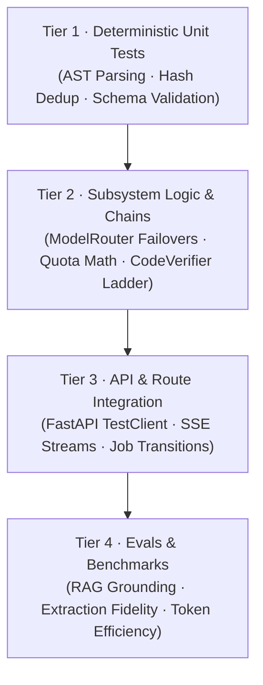
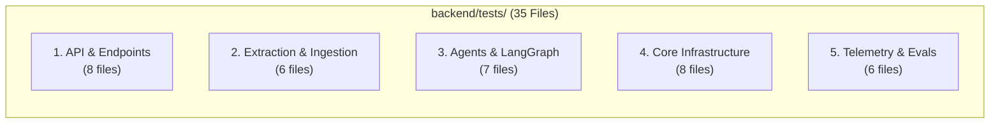
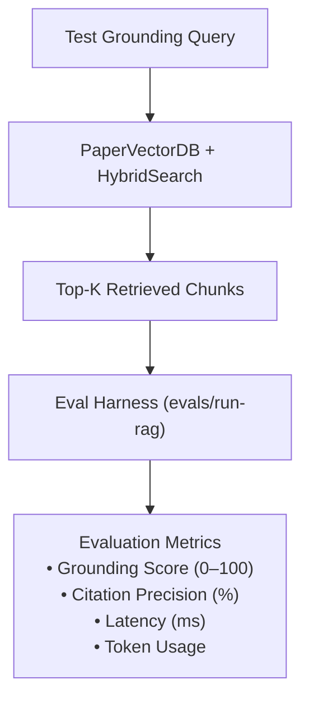

# Testing Strategy & Benchmarking Guide

> Comprehensive guide to test execution, mocking external services, running the 35-file backend test suite, and evaluating RAG/extraction accuracy in **RUEXIS AI (v2.0)**.

---

## 1. Testing Philosophy & Pyramid

RUEXIS AI employs a 4-tier testing hierarchy to balance fast developer feedback with deterministic agent validation:



* **Zero Cloud Dependency in CI:** All automated unit and component tests run using deterministic mocks — no live API keys or cloud spend required.
* **Async-First Execution:** Async tests use `pytest-asyncio` configured with `asyncio_mode = auto` in [backend/pytest.ini](../backend/pytest.ini).

---

## 2. Test Suite Inventory (35 Files)

The 35 test files in `backend/tests/` are organized into 5 functional categories:



### Detailed Breakdown

| Category | Key Test Modules | What They Verify |
|---|---|---|
| **1. API & Endpoints** | `test_api_v2.py`<br>`test_auth_routes.py`<br>`test_pipeline_jobs.py`<br>`test_chat_endpoints.py`<br>`test_hardware_routes.py` | FastAPI route status codes, Pydantic request validation, CORS headers, error response structures, and job cancellation. |
| **2. Extraction & Ingestion** | `test_docling_parser.py`<br>`test_pymupdf_parser.py`<br>`test_vlm_extractor.py`<br>`test_multimodal_vlm.py`<br>`test_hybrid_search.py` | Multi-engine PDF ingestion, table extraction, mathematical formula parsing, OCR fallbacks, and hybrid BM25 + dense vector ranking. |
| **3. Agents & LangGraph** | `test_langgraph_workflow.py`<br>`test_chat_agent.py`<br>`test_tools.py`<br>`test_episodic_memory.py` | 5-node autonomous graph execution, reflection loop triggers, tool calling contracts, and conversation memory persistence. |
| **4. Core Infrastructure** | `test_model_router.py`<br>`test_quota_tracker.py`<br>`test_daily_quota.py`<br>`test_dual_code_engine.py`<br>`test_code_verifier.py`<br>`test_dag_validator.py` | Multi-provider failover chains, rate-limit header parsing, AST code verification ladder, topological sorting, and cycle detection. |
| **5. Telemetry & Evals** | `test_telemetry.py`<br>`test_evals_rag.py`<br>`test_job_store.py`<br>`test_report_manifest.py` | SQLite WAL state machine, SSE progress broadcasting, manifest JSON schema conformity, and benchmark tracking. |

---

## 3. Running Tests

### Setup Test Dependencies
Ensure test packages are installed inside the Python virtual environment:
```powershell
pip install pytest pytest-asyncio httpx
```

### Common Test Execution Commands

```powershell
cd backend

# Run the entire test suite
python -m pytest tests/ -v

# Run in quiet mode (compact output)
python -m pytest tests/ -q

# Run a specific test file
python -m pytest tests/test_vlm_extractor.py -v
python -m pytest tests/test_pipeline_jobs.py -v

# Run tests matching a keyword pattern (e.g. all quota tests)
python -m pytest tests/ -k "quota" -v

# Stop immediately on first test failure (fail-fast)
python -m pytest tests/ -x

# Run only async integration tests
python -m pytest tests/test_api_v2.py -v
```

---

## 4. Mocking External LLM Providers & SSE Streams

To ensure reliable, cost-free testing, all provider calls are mocked in tests:

### Mocking Provider Adapters
```python
from unittest.mock import patch, MagicMock
import pytest

@pytest.mark.asyncio
async def test_model_router_fallback():
    with patch("app.providers.groq_adapter.complete") as mock_groq, \
         patch("app.providers.openrouter_adapter.complete") as mock_openrouter:
        
        # Simulate Groq 429 Rate Limit
        mock_groq.side_effect = Exception("Rate limit reached 429")
        mock_openrouter.return_value = "Fallback response from OpenRouter"
        
        from app.core.model_router import ModelRouter
        router = ModelRouter()
        result = await router.route_completion("Explain attention mechanism", model_id="qwen/qwen3.8-27b")
        
        assert "Fallback response" in result["content"]
        assert result["model_used"] != "qwen/qwen3.8-27b"
```

### Mocking SSE Event Ingestion
```python
from fastapi.testclient import TestClient
from main import app

def test_pipeline_sse_events():
    client = TestClient(app)
    # Trigger job
    res = client.post("/api/v1/pipeline/analyze", json={"filePath": "test.pdf", "modelName": "mock"})
    job_id = res.json()["job_id"]
    
    # Verify events endpoint connects with text/event-stream
    with client.stream("GET", f"/api/v1/pipeline/jobs/{job_id}/events") as response:
        assert response.status_code == 200
        assert "text/event-stream" in response.headers["content-type"]
```

---

## 5. RAG Evaluation Harness & Benchmarks

RUEXIS AI features a built-in evaluation framework for measuring RAG quality, factual grounding, and synthesis fidelity.

### Evaluation Workflow



### Triggering RAG Evaluation
To evaluate RAG retrieval against an uploaded paper:

```powershell
# Run RAG evaluation against a specific paper
curl -X POST http://localhost:8000/api/v1/evals/run-rag `
  -H "Content-Type: application/json" `
  -d '{"paper_id": "transformer_vaswani_2017"}'
```

### Querying System Baseline Metrics
To inspect baseline benchmarks and performance metrics:

```powershell
curl http://localhost:8000/api/v1/evals/baseline
```

### Evaluation Criteria

| Metric | Target | Description |
|---|---|---|
| **Grounding Score** | ≥ 85 / 100 | Percentage of assertions backed by direct source citations. |
| **Citation Precision** | ≥ 90% | Ratio of valid cited chunk IDs to hallucinated citations. |
| **Code Syntax Valid** | 100% | AST compilation pass rate across all synthesized code blocks. |
| **Pipeline Latency** | < 120s | End-to-end processing time for a standard 10-page paper. |

---

## 6. Frontend Quality & Smoke Testing

Frontend validation ensures type safety and IPC bridge stability:

```powershell
cd frontend/renderer

# 1. Type verification across all components, hooks, and stores
npm run typecheck

# 2. Linting verification
npm run lint

# 3. Production bundle compilation verification
npm run build
```

### DevTools IPC Smoke Test
In the running Electron app, open Developer Tools and verify the IPC bridge:
```javascript
// Test 1: Verify mascotAPI object existence
console.assert(typeof window.mascotAPI === 'object', "mascotAPI missing!");

// Test 2: Verify skin retrieval returns a string
window.mascotAPI.getMascotSkin().then(skin => console.log("Active Skin:", skin));
```
