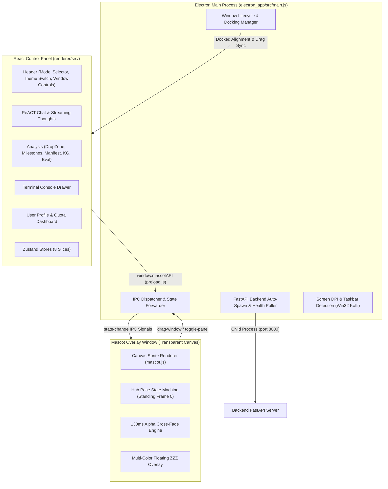

# 🎨 RUEXIS AI (v2.0) — Frontend Architecture & Overview

Comprehensive technical guide to the RUEXIS AI frontend architecture, dual-window Electron desktop container, mascot canvas sprite engine, React 19 control panel, Zustand reactive state stores, IPC messaging bridge, and modern design system.

---

## 🏗️ Architecture Overview

RUEXIS AI operates a **Dual-Window Electron Architecture** separating the lightweight, transparent desktop mascot overlay from the primary interactive control panel:

```
frontend/
├── electron_app/               # Native Electron 43 desktop container
│   ├── package.json            # Electron dependencies & build scripts
│   ├── mascot_transitions.json # FSM transition graph for mascot poses
│   ├── test_mascot.html        # Standalone mascot animation test harness
│   └── src/
│       ├── main.js             # Electron main process (lifecycle, IPC, backend spawn, DPI)
│       ├── preload.js          # Secure context bridge (exposes window.mascotAPI)
│       ├── mascot.html         # Mascot overlay DOM stage & ZZZ overlay container
│       ├── mascot.css          # Window styles, keyframes, cursor rules
│       ├── mascot.js           # 2D canvas sprite renderer, hub router, alpha cross-fade
│       └── assets/             # Character sprite sheets (mr_nerdy, ms_nerdy, mr_nerd, ms_nerd)
│
└── renderer/                   # React 19 + TypeScript + Vite UI Application
    ├── package.json            # React dependencies, scripts (dev, build, typecheck, lint)
    ├── vite.config.ts          # Vite configuration with React & Tailwind v4 plugins
    ├── index.html              # Single Page Application HTML shell
    ├── dist/                   # Production bundle compiled via `npm run build`
    └── src/
        ├── App.tsx             # Root desktop application & view router
        ├── index.css           # Tailwind v4 theme tokens (l1, l2, l3, d) & typography
        ├── config/             # Centralized API base URL & endpoints
        ├── constants/          # Model catalog fallbacks & failover resolver
        ├── schemas/            # Zod validation schemas for backend payloads
        ├── services/           # Backend HTTP fetchers & SSE parser
        ├── store/              # Zustand root store & 8 feature slices
        └── components/         # Layout scaffolding, feature views, and UI primitives
```

---

## 📊 Dual-Window System Architecture



---

## ⚛️ Dual-Window Modes & Window Lifecycle

### 1. Docked Floating Mode (Default)
- **Dimensions:** 340 × 480 px (scaled by display DPI factor).
- **Positioning:** Floating window positioned directly above the mascot with a `+16px` vertical offset to account for canvas transparency.
- **Lockstep Dragging:** Dragging the mascot character automatically moves the docked control panel in real-time sync with screen bounds clamping.

### 2. Maximized Workspace Mode
- **Dimensions:** Full-screen responsive workspace (minimum 800 × 600 px).
- **Behavior:** Triggered via the header expand button or the global shortcut `CommandOrControl+Shift+P`.
- **Mascot Auto-Hide:** When maximized, the mascot overlay is hidden to keep the workspace clean, reappearing upon unmaximizing.

---

## 🎭 Mascot Animation Engine (`electron_app/src/mascot.js`)

1. **Four Character Skins:**
   - `mr_nerdy` (Classic academic nerd)
   - `ms_nerdy` (Female academic variant)
   - `mr_nerd` (Compact nerd)
   - `ms_nerd` (Compact female variant)

2. **Hub Routing State Machine:**
   - All state transitions route through frame `0` of the standing pose (`idle`) as a central hub.
   - For example, transitioning from `sleep` to `hunch` (`working`):
     - Step 1: Reverse `sleep` sequence: Frame 2 ➔ Frame 1 ➔ Frame 0 (`standing`).
     - Step 2: Play `hunch` sequence: Frame 0 ➔ Frame 1 ➔ Frame 2 (`working`).

3. **Smooth Alpha Cross-Fading:**
   - Frame popping is eliminated via a 6-step `globalAlpha` cross-blend over 130ms.

4. **Multi-Color Floating ZZZ Overlay:**
   - Displays animated sleeping Zs directly above the mascot's head in three distinct colors:
     - **Z 1 (9px):** Sky Blue (`#38bdf8`)
     - **Z 2 (12px):** Violet Purple (`#a855f7`)
     - **Z 3 (15px):** Coral Rose (`#f43f5e`)

5. **Asynchronous State Queue:**
   - State updates sent mid-animation are buffered in a queue to prevent frame drops or rapid toggling glitches.

---

## 🎨 Design System & Theme Engine

The renderer utilizes a modern design system defined in `renderer/src/index.css` supporting **4 distinct theme variants**:

| Theme ID | Mode | Name | Key Aesthetic |
|----------|------|------|---------------|
| `l1` | Light | Warm Ivory | Warm parchment background, deep charcoal typography, warm brass accents |
| `l2` | Light | Arctic Frost | Crisp cool white background, glacial blue accents, high contrast slate text |
| `l3` | Light | Iris Violet | Soft lavender-tinted background, royal violet accents, balanced readable text |
| `d` | Dark | Slate Obsidian | Deep dark slate/charcoal background, neon cyan and amber accents |

Themes are persisted in `localStorage` via `themeStore.ts` and applied as class attributes on `document.documentElement`.

---

## 🧩 React Renderer Architecture & Store Slices

The UI state is managed via **Zustand 5** across 8 feature slices:

1. **`uiSlice.ts`** — Active theme, selected model ID, selected mascot skin, modal visibility.
2. **`chatSlice.ts`** — Conversation history, message feed, SSE streaming (status, thought, action, token), and auto-failover synchronization.
3. **`analysisSlice.ts`** — Paper ingestion, milestone progression, hyperparameter approval, and report viewing.
4. **`evalSlice.ts`** — RAG evaluation metrics (`RAGSummaryMetrics`), benchmark comparisons, latency & token cost metrics.
5. **`knowledgeGraphSlice.ts`** — Interactive SVG/Canvas entity-relationship knowledge graph inspection.
6. **`profileSlice.ts`** — User profile metadata, API key management (Groq, OpenRouter), and Ollama host configuration.
7. **`documentHistorySlice.ts`** — Ingested paper catalog, indexing status, and selection.
8. **`hardwareSlice.ts`** — Live host CPU/GPU load and system memory telemetry.

---

## 🚀 Running & Building

### Development Mode
```bash
# Terminal 1: Start React renderer Vite dev server
cd frontend/renderer
npm install
npm run dev

# Terminal 2: Launch Electron desktop container
cd frontend/electron_app
npm install
npm start
```

### Production Build
```bash
# 1. Compile React production bundle
cd frontend/renderer
npm run build

# 2. Run or package Electron application
cd ../electron_app
npm start          # Runs packaged dist bundle
npm run pack       # Builds unpacked executable directory
npm run dist       # Builds final Windows installer (.exe)
```

---

## 📚 Component Guides

- [Electron Application Guide](./electron_app/README.md) — Detailed main process, Win32 FFI, IPC channels, and mascot engine.
- [React Renderer Guide](./renderer/README.md) — UI components, Zustand stores, API services, and Vite configuration.
